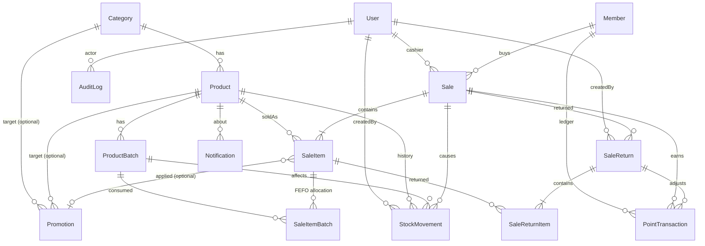

# SmartMart POS — แผนฉบับปรับปรุง v2 (Full Features / 10 วัน)

> สถานะ: **รออนุมัติ — ยังไม่เขียนโค้ด**
> เอกสารนี้ **แทนที่** ส่วนขอบเขต (Part 2), ฐานข้อมูล (Part 3) และแผน 10 วัน (Part 5) ใน `SmartMart-POS-Plan.md` ส่วนที่ไม่ขัดแย้ง (สถาปัตยกรรม, Design System, UI ของหน้าเดิม, Git/Workflow, แผนนำเสนอ) ยังใช้ตามฉบับแรก
> หมายเหตุ: ตัวเลขชั่วโมงเป็นการประเมินของผม ไม่ใช่ค่าที่วัดได้ ปรับได้หลังจบวันที่ 2 เมื่อเห็นความเร็วจริง

---

## 1. บทสรุปความเป็นไปได้ (ตรงไปตรงมา)

ฟีเจอร์ที่เพิ่มเข้ามา 6 ชุดคือ Membership/Loyalty, Promotion, Batch/FEFO, Return/Refund, Notification, Audit Log ทั้งหมดนี้ **ผูกเข้ากับ Checkout transaction เดียวกัน** ทำให้ความเสี่ยงไม่ได้เพิ่มแบบบวก แต่เพิ่มแบบคูณ (โปรโมชั่น × FEFO × คะแนน × คืนสินค้า)

| คำถาม | คำตอบ |
|---|---|
| ทำ Priority 1 ให้ทำงานจริงและถูกต้องได้ไหม | **ได้ มั่นใจสูง** (เสร็จภายในวันที่ 5) |
| ทำ Priority 2 ทุกโมดูลแบบ "พื้นฐานแต่ทำงานจริง" ได้ไหม | **เป็นไปได้ แต่ตึงมาก ไม่มี slack จริง** ผมประเมินว่าเสี่ยงพอ ๆ กับโอกาสสำเร็จ ถ้า Claude Code ทำงานได้ราบรื่นและคุณทดสอบทุกวัน |
| รับประกันได้ไหม | **ไม่รับประกัน** — จึงกำหนด "ระดับความสมบูรณ์ต่อโมดูล" (หัวข้อ 7) และ "ลำดับตัด" (หัวข้อ 8) ไว้ล่วงหน้า |

เงื่อนไขที่ทำให้แผนนี้เป็นไปได้:
1. Schema ครบทุกโมดูลตั้งแต่วันที่ 1 (ไม่กลับมาแก้ซ้ำ)
2. **ตรรกะเงินและสต็อกอยู่ในโมดูล `server/services` ชุดเดียว** ใช้ร่วมกันระหว่าง POS preview, Checkout และ Return
3. ทุกโมดูลระดับ Priority 2 ถูกจำกัดกติกาไว้ล่วงหน้า (หัวข้อ 5) ห้ามขยายระหว่างทาง
4. Day 9–10 ใช้ทดสอบ/Deploy เท่านั้น ถ้าถึงวันที่ 8 แล้วยังไม่ครบ ให้ **ตัดตามลำดับ ไม่ยืด Day 9–10**

---

## 2. ส่วนที่ต้องปรับจากแผนเดิม

| # | เรื่อง | แผนเดิม (v1) | v2 | เหตุผล |
|---|---|---|---|---|
| 1 | ขอบเขต | ตัด Membership/Promotion/Batch/Return/Audit/Notification | **รวมทั้งหมด** | คุณเลือก Full Features |
| 2 | Inventory | ยุบเป็น `Product.stockQty` | **`ProductBatch` เป็นแหล่งความจริงของสต็อก**; `Product.stockQty` เป็นยอดรวมที่ cache (อัปเดตใน transaction เดียวกัน) | FEFO ต้องมีล็อต |
| 3 | สินค้าไม่มีวันหมดอายุ | – | **ทุกสินค้าใช้ batch** สินค้าที่ไม่มี expiry มี batch ที่ `expiryDate = null` (เรียงท้ายสุดใน FEFO) | โค้ดเส้นทางเดียว ไม่ต้องแยก `trackBatch` สองแบบ |
| 4 | ลำดับ Checkout | v1: Day 3 | **Day 5** (เงินสด + FEFO + ใบเสร็จ) แล้วต่อ Promotion/Loyalty ใน Day 6 | ต้องมี Product + Batch ก่อน แต่ **ไม่รอ Promotion/Member**: Checkout แกนกลางต้องจบก่อนต่อยอด |
| 5 | ลำดับตามที่คุณเสนอ | Checkout อยู่ Day 6 พร้อม Promotion | **แยกเป็นสองชั้น**: Day 5 = Checkout แกน, Day 6 = เสียบ Promotion + Member เข้า pricing/checkout | ถ้า Day 6 พังพร้อมกันทั้งก้อน (โปรโมชั่น+Checkout+ใบเสร็จ) จะไม่มีระบบขายที่ใช้ได้เหลือ |
| 6 | User Management | Day 6 | **Day 2** (ตามที่คุณเสนอ) | ง่าย อยู่กับ Auth ได้ |
| 7 | Audit Log | ตัดออก | **Day 2 สร้าง helper `audit()`** แล้วให้ทุกโมดูลเรียกใช้ตั้งแต่เกิด; Day 7 ทำหน้าดู | ถ้าทำท้ายสุดต้องย้อนแก้ทุกโมดูล |
| 8 | Notification | ตัดออก | **In-app เท่านั้น** (ไม่มี cron) คำนวณเมื่อเปิดหน้า/หลังขาย พร้อม dedupe | ไม่มี cron/queue |
| 9 | Dashboard/Report/BI | Day 5–6 | **Day 8** ตามที่คุณเสนอ | ข้อมูลต้องครบก่อน |
| 10 | ข้อมูล demo ย้อนหลัง | Day 5 | **Day 8 ต้นวัน** สร้างผ่าน checkout service จริง | ต้องมี FEFO/โปรโมชั่น/แต้มในข้อมูล |
| 11 | Payment | ยุบเข้า Sale | คงเดิม (เงินสดเท่านั้น) คืนเงินเป็นเงินสด | ยังไม่มี Split Payment/Gateway |
| 12 | ส่วนที่ยัง **ไม่ทำ** (Priority 3) | – | หลายสาขา, Advanced Promotion/BI/Forecast, Email/Push, External AI, Payment Gateway, Split Payment, Offline, ซัพพลายเออร์/PO | ตามที่คุณระบุ |

---

## 3. Dependencies ระหว่างโมดูล

```
Schema(D1) ─► Auth/Users/Audit helper(D2)
            ─► Category/Product(D3) ─► Batch/Inventory + FEFO service(D4)
                                           │
                                           ▼
                       POS + Checkout แกน + Receipt (D5)   ◄── Priority 1 เสร็จ
                           │            │
              Promotion + Member/Loyalty (D6) ──► (เสียบเข้า pricing + checkout)
                           │
                Sales History + Return/Refund + Notification + Audit UI (D7)
                           │   (Return ต้องมี Sale + SaleItemBatch + แต้ม)
                           ▼
                 Reports + Dashboard + Smart BI (D8) ─► Integration/Test (D9) ─► Deploy (D10)
```

โมดูลที่ **ห้ามสลับลำดับ**: FEFO service ก่อน Checkout; Checkout ก่อน Return; Promotion/Member ก่อน Return (ต้องคืนแต้มและส่วนลด)

---

## 4. การออกแบบฐานข้อมูล v2 (รองรับทุกโมดูลตั้งแต่ Day 1)

### 4.1 ER Diagram



### 4.2 Prisma Schema v2 (ฉบับเต็ม)

```prisma
generator client { provider = "prisma-client-js" }

datasource db {
  provider  = "postgresql"
  url       = env("DATABASE_URL")
  directUrl = env("DIRECT_URL")
}

enum Role { ADMIN CASHIER }
enum StockMovementType { INITIAL RESTOCK SALE ADJUSTMENT RETURN }
enum PaymentMethod { CASH }
enum SaleStatus { COMPLETED PARTIALLY_RETURNED FULLY_RETURNED }
enum PromotionScope { PRODUCT CATEGORY BILL }
enum DiscountType { PERCENT FIXED }
enum PointType { EARN REDEEM RETURN_ADJUST }
enum NotificationType { LOW_STOCK OUT_OF_STOCK NEAR_EXPIRY EXPIRED }

model User {
  id           String   @id @default(uuid()) @db.Uuid
  email        String   @unique
  name         String
  passwordHash String
  role         Role     @default(CASHIER)
  isActive     Boolean  @default(true)
  createdAt    DateTime @default(now())
  updatedAt    DateTime @updatedAt

  sales          Sale[]
  stockMovements StockMovement[]
  returns        SaleReturn[]
  auditLogs      AuditLog[]
}

model Category {
  id          String   @id @default(uuid()) @db.Uuid
  name        String   @unique
  description String?
  createdAt   DateTime @default(now())
  updatedAt   DateTime @updatedAt

  products   Product[]
  promotions Promotion[]
}

model Product {
  id         String   @id @default(uuid()) @db.Uuid
  sku        String   @unique
  barcode    String?  @unique
  name       String
  categoryId String   @db.Uuid
  costPrice  Decimal  @db.Decimal(12, 2)
  price      Decimal  @db.Decimal(12, 2)
  unit       String   @default("ชิ้น")
  stockQty   Int      @default(0) // cache = SUM(batch.remainingQty) ; แก้ผ่าน stock service เท่านั้น
  minStock   Int      @default(0)
  isActive   Boolean  @default(true)
  createdAt  DateTime @default(now())
  updatedAt  DateTime @updatedAt

  category       Category        @relation(fields: [categoryId], references: [id], onDelete: Restrict)
  batches        ProductBatch[]
  stockMovements StockMovement[]
  saleItems      SaleItem[]
  promotions     Promotion[]
  notifications  Notification[]

  @@index([categoryId])
  @@index([name])
  @@index([isActive])
}

model ProductBatch {
  id           String    @id @default(uuid()) @db.Uuid
  productId    String    @db.Uuid
  batchNo      String
  expiryDate   DateTime? @db.Date // null = ไม่มีวันหมดอายุ (เรียงท้ายสุดใน FEFO)
  receivedAt   DateTime  @default(now())
  costPrice    Decimal   @db.Decimal(12, 2)
  initialQty   Int
  remainingQty Int
  createdAt    DateTime  @default(now())

  product        Product         @relation(fields: [productId], references: [id], onDelete: Restrict)
  stockMovements StockMovement[]
  saleItemBatches SaleItemBatch[]
  notifications  Notification[]

  @@unique([productId, batchNo])
  @@index([productId, expiryDate])
  @@index([expiryDate])
}

model StockMovement {
  id             String            @id @default(uuid()) @db.Uuid
  productId      String            @db.Uuid
  batchId        String?           @db.Uuid
  type           StockMovementType
  quantityChange Int
  balanceAfter   Int               // ยอดรวมของสินค้าหลังเคลื่อนไหว
  note           String?
  saleId         String?           @db.Uuid
  returnId       String?           @db.Uuid
  createdById    String            @db.Uuid
  createdAt      DateTime          @default(now())

  product   Product       @relation(fields: [productId], references: [id], onDelete: Restrict)
  batch     ProductBatch? @relation(fields: [batchId], references: [id], onDelete: Restrict)
  sale      Sale?         @relation(fields: [saleId], references: [id], onDelete: Restrict)
  saleReturn SaleReturn?  @relation(fields: [returnId], references: [id], onDelete: Restrict)
  createdBy User          @relation(fields: [createdById], references: [id], onDelete: Restrict)

  @@index([productId, createdAt])
  @@index([batchId])
  @@index([saleId])
}

model Member {
  id         String   @id @default(uuid()) @db.Uuid
  code       String   @unique // เช่น M0001
  name       String
  phone      String   @unique
  email      String?
  points     Int      @default(0) // ยอดคงเหลือ cache = SUM(PointTransaction.points)
  totalSpent Decimal  @default(0) @db.Decimal(12, 2)
  isActive   Boolean  @default(true)
  createdAt  DateTime @default(now())
  updatedAt  DateTime @updatedAt

  sales  Sale[]
  points_ PointTransaction[]

  @@index([name])
}

model PointTransaction {
  id           String    @id @default(uuid()) @db.Uuid
  memberId     String    @db.Uuid
  saleId       String?   @db.Uuid
  returnId     String?   @db.Uuid
  type         PointType
  points       Int       // บวก = ได้, ลบ = ใช้/หัก
  balanceAfter Int
  note         String?
  createdAt    DateTime  @default(now())

  member Member      @relation(fields: [memberId], references: [id], onDelete: Restrict)
  sale   Sale?       @relation(fields: [saleId], references: [id], onDelete: Restrict)
  saleReturn SaleReturn? @relation(fields: [returnId], references: [id], onDelete: Restrict)

  @@index([memberId, createdAt])
}

model Promotion {
  id           String         @id @default(uuid()) @db.Uuid
  name         String
  scope        PromotionScope // PRODUCT | CATEGORY | BILL
  discountType DiscountType   // PERCENT | FIXED
  value        Decimal        @db.Decimal(12, 2) // % หรือ บาท
  productId    String?        @db.Uuid
  categoryId   String?        @db.Uuid
  minPurchase  Decimal?       @db.Decimal(12, 2) // ใช้กับ BILL
  startsAt     DateTime
  endsAt       DateTime
  isActive     Boolean        @default(true)
  createdAt    DateTime       @default(now())
  updatedAt    DateTime       @updatedAt

  product   Product?   @relation(fields: [productId], references: [id], onDelete: Restrict)
  category  Category?  @relation(fields: [categoryId], references: [id], onDelete: Restrict)
  saleItems SaleItem[]

  @@index([isActive, startsAt, endsAt])
}

model Sale {
  id             String        @id @default(uuid()) @db.Uuid
  saleNo         Int           @unique @default(autoincrement())
  receiptNo      String        @unique
  idempotencyKey String        @unique
  cashierId      String        @db.Uuid
  memberId       String?       @db.Uuid
  status         SaleStatus    @default(COMPLETED)
  subtotal       Decimal       @db.Decimal(12, 2) // ก่อนส่วนลด
  discountTotal  Decimal       @default(0) @db.Decimal(12, 2)
  total          Decimal       @db.Decimal(12, 2) // subtotal - discountTotal
  paymentMethod  PaymentMethod @default(CASH)
  amountPaid     Decimal       @db.Decimal(12, 2)
  changeAmount   Decimal       @db.Decimal(12, 2)
  pointsEarned   Int           @default(0)
  pointsRedeemed Int           @default(0)
  createdAt      DateTime      @default(now())

  cashier          User               @relation(fields: [cashierId], references: [id], onDelete: Restrict)
  member           Member?            @relation(fields: [memberId], references: [id], onDelete: Restrict)
  items            SaleItem[]
  stockMovements   StockMovement[]
  pointTransactions PointTransaction[]
  returns          SaleReturn[]

  @@index([createdAt])
  @@index([cashierId])
  @@index([memberId])
}

model SaleItem {
  id           String   @id @default(uuid()) @db.Uuid
  saleId       String   @db.Uuid
  productId    String   @db.Uuid
  promotionId  String?  @db.Uuid
  skuSnapshot  String
  nameSnapshot String
  unitPrice    Decimal  @db.Decimal(12, 2)
  unitCost     Decimal  @db.Decimal(12, 2) // ทุนถัวจาก batch ที่ตัดจริง
  quantity     Int
  returnedQty  Int      @default(0)
  lineTotal    Decimal  @db.Decimal(12, 2) // unitPrice * quantity
  discountAmount Decimal @default(0) @db.Decimal(12, 2) // ส่วนลดรายการ + ส่วนลดบิลที่กระจายมา
  netTotal     Decimal  @db.Decimal(12, 2) // lineTotal - discountAmount (ฐานคิดเงินคืน)

  sale      Sale            @relation(fields: [saleId], references: [id], onDelete: Cascade)
  product   Product         @relation(fields: [productId], references: [id], onDelete: Restrict)
  promotion Promotion?      @relation(fields: [promotionId], references: [id], onDelete: Restrict)
  batches   SaleItemBatch[]
  returnItems SaleReturnItem[]

  @@index([saleId])
  @@index([productId])
}

model SaleItemBatch { // ตัดจาก batch ไหนเท่าไร (ใช้คืนสต็อกให้ถูกล็อต)
  id         String  @id @default(uuid()) @db.Uuid
  saleItemId String  @db.Uuid
  batchId    String  @db.Uuid
  quantity   Int
  unitCost   Decimal @db.Decimal(12, 2)

  saleItem SaleItem     @relation(fields: [saleItemId], references: [id], onDelete: Cascade)
  batch    ProductBatch @relation(fields: [batchId], references: [id], onDelete: Restrict)

  @@index([saleItemId])
  @@index([batchId])
}

model SaleReturn {
  id            String   @id @default(uuid()) @db.Uuid
  returnNo      String   @unique // เช่น RT-20261101-0001
  returnSeq     Int      @unique @default(autoincrement())
  saleId        String   @db.Uuid
  reason        String
  refundTotal   Decimal  @db.Decimal(12, 2) // คืนเงินสด
  pointsReversed Int     @default(0)
  createdById   String   @db.Uuid
  createdAt     DateTime @default(now())

  sale      Sale             @relation(fields: [saleId], references: [id], onDelete: Restrict)
  createdBy User             @relation(fields: [createdById], references: [id], onDelete: Restrict)
  items     SaleReturnItem[]
  stockMovements StockMovement[]
  pointTransactions PointTransaction[]

  @@index([saleId])
  @@index([createdAt])
}

model SaleReturnItem {
  id           String  @id @default(uuid()) @db.Uuid
  returnId     String  @db.Uuid
  saleItemId   String  @db.Uuid
  quantity     Int
  refundAmount Decimal @db.Decimal(12, 2)
  restock      Boolean @default(true) // false = ของเสีย ไม่คืนเข้าสต็อก

  saleReturn SaleReturn @relation(fields: [returnId], references: [id], onDelete: Cascade)
  saleItem   SaleItem   @relation(fields: [saleItemId], references: [id], onDelete: Restrict)

  @@index([returnId])
  @@index([saleItemId])
}

model Notification {
  id        String           @id @default(uuid()) @db.Uuid
  type      NotificationType
  title     String
  message   String
  productId String?          @db.Uuid
  batchId   String?          @db.Uuid
  dedupeKey String           @unique // เช่น LOW_STOCK:{productId}:{yyyy-MM-dd} กันแจ้งซ้ำ
  isRead    Boolean          @default(false)
  createdAt DateTime         @default(now())

  product Product?      @relation(fields: [productId], references: [id], onDelete: Cascade)
  batch   ProductBatch? @relation(fields: [batchId], references: [id], onDelete: Cascade)

  @@index([isRead, createdAt])
}

model AuditLog {
  id        String   @id @default(uuid()) @db.Uuid
  userId    String?  @db.Uuid
  action    String   // เช่น PRODUCT_PRICE_CHANGE, STOCK_ADJUST, SALE_RETURN, USER_ROLE_CHANGE
  entity    String
  entityId  String?
  before    Json?
  after     Json?
  createdAt DateTime @default(now())

  user User? @relation(fields: [userId], references: [id], onDelete: SetNull)

  @@index([entity, entityId])
  @@index([createdAt])
  @@index([userId])
}

model SystemSetting {
  id        String   @id @default(uuid()) @db.Uuid
  key       String   @unique
  value     String
  updatedAt DateTime @updatedAt
}
```

**SQL เพิ่มใน migration (CHECK):**
```sql
ALTER TABLE "Product"      ADD CONSTRAINT product_stock_nonneg CHECK ("stockQty" >= 0);
ALTER TABLE "ProductBatch" ADD CONSTRAINT batch_remaining_range CHECK ("remainingQty" >= 0 AND "remainingQty" <= "initialQty");
ALTER TABLE "SaleItem"     ADD CONSTRAINT saleitem_qty_pos CHECK ("quantity" > 0 AND "returnedQty" >= 0 AND "returnedQty" <= "quantity");
ALTER TABLE "SaleItem"     ADD CONSTRAINT saleitem_net_nonneg CHECK ("netTotal" >= 0);
ALTER TABLE "Member"       ADD CONSTRAINT member_points_nonneg CHECK ("points" >= 0);
ALTER TABLE "Sale"         ADD CONSTRAINT sale_paid_enough CHECK ("amountPaid" >= "total");
```
> หมายเหตุ: ใน Prisma ชื่อ relation `points_` ใน Member ควรตั้งชื่อใหม่ให้สื่อความหมาย (เช่น `pointLedger`) ตอนเขียนจริง ตัวอย่างข้างบนคือโครงร่าง

### 4.3 กติกาธุรกิจที่ตรึงไว้ (ลดความซับซ้อน — ห้ามขยายระหว่างทาง)

**FEFO**
- เลือก batch ที่ `remainingQty > 0` และ **ไม่หมดอายุ** (`expiryDate IS NULL OR expiryDate >= วันนี้ (Bangkok)`) เรียง `expiryDate ASC NULLS LAST, receivedAt ASC`
- ตัดข้ามหลาย batch ได้; บันทึก `SaleItemBatch` + `StockMovement` ต่อ batch
- สต็อกที่หมดอายุ **ไม่ถูกขาย** แต่ยังอยู่ใน `stockQty`; Notification แจ้งให้ ADMIN ตัดทิ้งด้วย Stock Adjustment
- "จำนวนที่ขายได้" ใน POS = Σ remainingQty ของ batch ที่ไม่หมดอายุ (query เดียว ไม่ใช้ `stockQty`)
- ล็อกแถว batch ด้วยการ UPDATE แบบมีเงื่อนไข (`remainingQty >= n`), เรียงลำดับ id ก่อนอัปเดตกัน deadlock

**Promotion** (Basic เท่านั้น)
- scope: `PRODUCT` / `CATEGORY` / `BILL`; ชนิดลด `PERCENT` / `FIXED`; ช่วงเวลา + เปิด/ปิด; `BILL` มี `minPurchase`
- **ไม่ stack ต่อรายการ**: รายการหนึ่งใช้โปรโมชั่น PRODUCT/CATEGORY ที่ลดได้มากที่สุดเพียงอันเดียว
- โปรโมชั่น BILL ใช้ได้ 1 อัน (อันที่ลดมากสุด) คิดจากยอดหลังลดรายการ
- ส่วนลด BILL กระจายลงแต่ละบรรทัดตามสัดส่วน (บรรทัดสุดท้ายรับเศษ) เพื่อให้ `SaleItem.netTotal` ใช้คำนวณเงินคืนได้ตรงเป๊ะ
- ไม่มี Buy X Get Y, ไม่มีคูปองโค้ด

**Loyalty** (Basic)
- ได้แต้ม = `floor(total / X บาท)` (ค่า `X` ใน SystemSetting, ค่าเริ่มต้น 25)
- ใช้แต้ม (Redeem) = ตัวเลือกเสริม: 1 แต้ม = 1 บาท เป็นส่วนลดระดับบิล, ไม่เกินยอดและไม่เกินแต้มคงเหลือ → **ตัดเป็นอย่างแรกถ้าเวลาไม่พอ** (ถ้าตัด ยังมี Earn)
- ไม่มีระดับสมาชิก/หมดอายุแต้ม

**Return/Refund** (Basic)
- ต้องอ้างอิงบิลเดิมเท่านั้น; คืนบางรายการ/บางจำนวนได้ (สะสมไม่เกินจำนวนที่ซื้อ); เหตุผลบังคับ
- คืนเงินสด = Σ (`netTotal / quantity × จำนวนที่คืน`) ปัดตามกติกากลาง; `restock` เลือกได้
- คืนสต็อกเข้า **batch เดิมจาก SaleItemBatch** (ใส่ใหม่ย้อนจากล็อตที่ตัดทีหลังสุด); `restock=false` ไม่คืนสต็อก
- หักแต้มที่ได้ตามสัดส่วน (ไม่ต่ำกว่า 0); ปรับ `Sale.status` อัตโนมัติ
- ไม่มีการคืนแต้มที่ใช้แล้ว (ถ้ามี redeem: คืนแต้มตามสัดส่วนส่วนลดที่คืน — ถ้าซับซ้อนให้ไม่รองรับคืนบิลที่ใช้แต้มใน MVP และแจ้งผู้ใช้ชัดเจน)

**Notification** (In-app)
- ชนิด: ใกล้หมด, หมด, ใกล้หมดอายุ (≤ 30 วัน ตั้งค่าได้), หมดอายุ
- สร้างโดยฟังก์ชัน `syncNotifications()` เรียกหลัง checkout/adjust และเมื่อ ADMIN เปิดหน้า Dashboard/Notifications; กันซ้ำด้วย `dedupeKey`
- ไม่มี email/push/cron

**Audit Log**
- บันทึกเหตุการณ์สำคัญเท่านั้น: เปลี่ยนราคา/ทุน, ปิดสินค้า, ปรับสต็อก, รับสินค้าเข้า, สร้าง/แก้/ปิดผู้ใช้และเปลี่ยน role, สร้าง/แก้โปรโมชั่น, คืนสินค้า, แก้ Settings, ล็อกอินล้มเหลว (สรุป)
- เขียนใน transaction เดียวกับการกระทำ; หน้าดูแบบอ่านอย่างเดียว กรองตามผู้ใช้/entity/วันที่
- ไม่มี diff viewer, ไม่มีการ export

### 4.4 กฎเดียวกันที่ใช้ทุกที่ (ลดบั๊ก)

| ฟังก์ชันกลาง | ใช้โดย |
|---|---|
| `pricing.calculate(cart, member, now)` — pure function, ได้ผลเป็น Decimal | POS preview (Server Action `quoteCart`), Checkout |
| `stock.allocateFefo(tx, productId, qty)` | Checkout |
| `stock.restoreToBatches(tx, saleItem, qty)` | Return |
| `stock.recalculateProduct(tx, productId)` | หลังทุกการเปลี่ยนแปลง batch (ตั้ง `stockQty`) |
| `audit(tx, {...})` | ทุก service |
| `lib/date.ts` (Asia/Bangkok) | ทุกที่ |

**ห้ามให้ client คำนวณส่วนลดเอง** — POS เรียก `quoteCart` ฝั่ง server เพื่อแสดงยอดสด และ Checkout คำนวณซ้ำฝั่ง server เสมอ

### 4.5 Seed Data
ผู้ใช้ 2–3 คน, หมวด 7, สินค้า 50+ (บางตัวมีหลาย batch วันหมดอายุต่างกัน, บางตัวใกล้หมดอายุ/หมดอายุแล้ว, บางตัวสต็อกต่ำ), สมาชิก 8–10 คน, โปรโมชั่น 4–5 (หนึ่งหมดอายุแล้ว, หนึ่งยังไม่เริ่ม), SystemSetting ครบ — ส่วน **ยอดขายย้อนหลัง/การคืน** สร้างด้วย `seed:demo` ที่เรียก service จริง (Day 8)

---

## 5. Roadmap ฉบับปรับปรุง (ประเมินเวลา = ชั่วโมงทำงานจริงรวม Claude Code + ทดสอบโดยคุณ)

**ความยาก:** 🟢 ง่าย 🟡 กลาง 🔴 เสี่ยง · **งานเสี่ยงสูงทำเร็ว:** FEFO (D4), Checkout (D5), Promotion/Return (D6–7)

### Day 1 — Foundation & Database 🟡
| Task | ชม. |
|---|---|
| สร้างโปรเจกต์ + shadcn + deps (ตามชุดเดิม) | 1.5 |
| เขียน Schema v2 + CHECK + migrate (Neon dev/prod) | 2.5 |
| Seed (ย่อ: ผู้ใช้, หมวด, สินค้า, batch, สมาชิก, โปรโมชั่น, settings) | 2 |
| `lib/money.ts`, `lib/date.ts`, Prisma singleton, โครงโฟลเดอร์, `CLAUDE.md` | 1 |
| ER Diagram ลง docs, push GitHub, deploy skeleton ขึ้น Vercel | 1.5 |
- **DoD:** `prisma validate` + migrate ผ่าน; ทดสอบ CHECK ทุกข้อ (ใส่ค่าผิดต้องถูกปฏิเสธ); seed รันซ้ำได้; deploy อ่าน DB ได้
- **สำรอง:** ถ้า schema ใหญ่เกินจนใช้เวลาเกิน → ทำ model ของ P2 ให้เป็น stub ตามที่ออกแบบ (ไม่ต้องมี seed ของโมดูลนั้น) แต่ **ห้ามเลื่อน schema ไปวันอื่น**

### Day 2 — Auth, Layout, Users, Audit helper 🟡
| Task | ชม. |
|---|---|
| Session (jose) + login/logout + guard `requireRole` + middleware | 2.5 |
| Layout: Sidebar ตาม role, Topbar, ส่วนประกอบกลาง (EmptyState, PageHeader, StatCard) | 2 |
| User Management (เพิ่ม/แก้ role/ปิด/รีเซ็ตรหัส, กัน self-lockout) | 2 |
| `audit()` helper + ใช้กับ user actions | 1 |
| ทดสอบสิทธิ์ | 1 |
- **DoD:** เรียก Server Action ด้วย CASHIER ถูกปฏิเสธ; Audit มีบันทึกจากการจัดการผู้ใช้
- **สำรอง:** เมนู Notification/Audit/Members แสดงเป็นลิงก์ที่ซ่อนไว้จนถึงวันที่ทำจริง (ห้ามมีหน้าเปล่าที่ "ดูเหมือนเสร็จ")

### Day 3 — Category & Product 🟡
| Task | ชม. |
|---|---|
| Category CRUD (+ Restrict) | 1.5 |
| Product CRUD: SKU/Barcode/ราคา/หน่วย/min, ค้นหา, กรอง, ปิดใช้งาน | 4 |
| ตอนสร้างสินค้า + สต็อกเริ่มต้น → สร้าง batch (INITIAL) ผ่าน `stock` service | 1.5 |
| Audit: แก้ราคา/ทุน/ปิดสินค้า | 0.5 |
| ทดสอบ | 1 |
- **DoD:** SKU/Barcode ซ้ำถูกปฏิเสธ; สร้างสินค้า → มี batch + movement + stockQty ตรงกัน
- **สำรอง:** ตัดการกรองขั้นสูง/pagination ไป Day 9

### Day 4 — Inventory, Batch, FEFO service 🔴
| Task | ชม. |
|---|---|
| รับสินค้าเข้า (สร้าง batch: เลขล็อต, วันหมดอายุ, ทุน, จำนวน) | 2 |
| Stock Adjustment ราย batch (เพิ่ม/ลด/ตั้งค่า + เหตุผล, ไม่ติดลบ) | 1.5 |
| หน้า Inventory: คงเหลือ, ราย batch, ประวัติ movement, Low-stock, รายการใกล้หมดอายุ/หมดอายุ | 2.5 |
| **`allocateFefo` + `recalculateProduct` + unit test** (หลาย batch, ข้ามล็อต, ล็อตหมดอายุ, ไม่พอ) | 2.5 |
| `syncNotifications()` เวอร์ชันแรก (low stock, expiry) + กระดิ่งในแถบบน | 1 |
- **DoD:** unit test FEFO ผ่าน ≥ 6 เคส; Σ batch = stockQty เสมอ; Audit ของ adjust
- **สำรอง:** ถ้า UI Inventory ไม่ทัน ทำตารางรวมก่อน (ไม่แยก tab); notification ทำแค่ low-stock/หมดอายุ

### Day 5 — POS + Checkout แกน + Receipt 🔴 (Priority 1 ต้องจบวันนี้)
| Task | ชม. |
|---|---|
| POS UI: ค้นหา/สแกน SKU-Barcode, กริดสินค้า, ตะกร้า, +/−/ลบ, แสดง "ขายได้" ตาม batch | 3 |
| `checkout` service: Zod → ตรวจ → FEFO → Sale/SaleItem/SaleItemBatch/StockMovement ใน transaction เดียว + idempotency + receiptNo | 2.5 |
| PaymentDialog เงินสด/เงินทอน | 1 |
| ใบเสร็จเต็ม + print CSS | 1.5 |
| Sales History แบบเรียบ (รายการ + ค้นเลขที่) เพื่อดูบิลที่เพิ่งขาย | 1 |
| Test: checkout 8 เคส (rollback, ขายซ้ำ, พร้อมกัน, ล็อตหมดอายุ ฯลฯ) | 1 |
- **ทำให้เสร็จก่อน Promotion/Member:** pricing function รับ promotion/member เป็น input ว่างไปก่อน (ลดส่วนลด = 0)
- **DoD:** ขายเงินสดครบวงจร, สต็อกตัดตาม FEFO, rollback ถูกต้อง, tag `p1-core`
- **สำรอง:** ถ้าเลยเที่ยงคืนยังไม่ผ่านเทสต์ checkout → **หยุดงาน UI ทั้งหมด** แล้วแก้ checkout ก่อน (ใช้เวลาจาก Day 6 โดยเลื่อน Loyalty-redeem ออก)

### Day 6 — Promotion, Membership/Loyalty เสียบเข้า Checkout 🔴
| Task | ชม. |
|---|---|
| Promotion CRUD + หน้า | 2 |
| `pricing.calculate` เต็มรูป (รายการ + บิล + กระจายส่วนลด + ปัดเศษ) + unit test หนัก (≥ 10 เคส) | 2.5 |
| `quoteCart` action + แสดงส่วนลด/โปรโมชั่นที่ใช้ในตะกร้า | 1 |
| Member CRUD + ค้นหาด้วยเบอร์/รหัส + เลือกสมาชิกใน POS | 2 |
| Loyalty: ได้แต้มใน checkout + `PointTransaction` + หน้าประวัติแต้ม (Redeem = ทำถ้ามีเวลา) | 1.5 |
| ใบเสร็จ: แสดงส่วนลด/สมาชิก/แต้ม | 0.5 |
| Audit: โปรโมชั่น | 0.5 |
- **DoD:** บิลที่มีโปรโมชั่น+สมาชิก: `Σ SaleItem.netTotal = Sale.total` เสมอ (ตรวจด้วย SQL), แต้มถูก, rollback ครอบคลุมแต้ม
- **สำรอง:** ตัด Redeem; ตัดโปรโมชั่น CATEGORY (เหลือ PRODUCT + BILL)

### Day 7 — Sales Detail, Return/Refund, Notification, Audit UI 🔴
| Task | ชม. |
|---|---|
| Sales History เต็ม: กรองวัน, รายละเอียดบิล, สถานะ | 1.5 |
| `returnSale` service: ตรวจจำนวนสะสม, คำนวณเงินคืนจาก netTotal, คืน batch เดิม, หักแต้ม, อัปเดตสถานะ, audit | 3 |
| UI คืนสินค้า (เลือกรายการ/จำนวน/เหตุผล/restock) + ใบคืนเงินพิมพ์ได้แบบเรียบ | 1.5 |
| Notification Center (รายการ, อ่านแล้ว, ลิงก์ไปสินค้า) | 1 |
| Audit Log หน้าดู + กรอง | 1 |
| Test: return 8 เคส | 1 |
- **DoD:** คืนบางส่วน→คืนส่วนที่เหลือ→พยายามคืนเกิน ถูกปฏิเสธ; สต็อก/แต้ม/ยอดสอดคล้อง
- **สำรอง:** ตัด "คืนบิลที่ใช้แต้ม", ตัด `restock=false`, ตัดพิมพ์ใบคืนเงิน

### Day 8 — Reports, Dashboard, Smart BI 🟡
| Task | ชม. |
|---|---|
| **`seed:demo`** ยอดขาย 30 วัน + การคืนเล็กน้อยผ่าน service จริง | 1.5 |
| Reports service (รายวัน, ขายดี, ขายช้า, กำไรจาก unitCost, ยอดหักคืนสินค้า) + หน้า Reports + Recharts | 2.5 |
| Dashboard (4 การ์ด + กราฟ + ขายดี + ใกล้หมด/หมดอายุ + การ์ด BI) | 2 |
| Smart BI: ขายดี, ขายช้า, days-of-cover, สต็อกใกล้หมดอายุที่ควรเร่งระบาย, เปรียบเทียบวัน, เทรนด์ 7 วัน (Rule-based, แสดงสูตร) | 2 |
- **นิยามต้องชัด:** ยอดขายสุทธิ = Σ Sale.total − Σ SaleReturn.refundTotal (ระบุบนรายงาน)
- **DoD:** ตัวเลขตรงกับ SQL ตรวจมือ 3 จุด
- **สำรอง:** BI เหลือ 4 กฎ; Dashboard ไม่มีกราฟที่สอง

### Day 9 — Integration & Testing (ห้ามเพิ่มฟีเจอร์) 🟡
- รัน `verify-integrity` ครบชุด: stockQty = Σ batch.remainingQty; batch ไม่ติดลบ; Σ netTotal = total; points = Σ PointTransaction; returnedQty ไม่เกิน quantity; receiptNo/returnNo ไม่ซ้ำ
- เดิน workflow end-to-end ทั้งสอง role: ขาย(โปรโมชั่น+สมาชิก+FEFO) → คืน → รายงาน
- ทดสอบความปลอดภัยพื้นฐาน (เข้า URL ตรง, action ไม่มีสิทธิ์, SQL injection/XSS)
- แก้บั๊ก, ขัดเกลา UI (3 สถานะทุกหน้า, tablet), เขียน `TEST-CHECKLIST.md` ด้วยผลจริง
- **สำรอง:** บั๊กเยอะ → ตัด polish ก่อน ไม่ตัดการทดสอบความถูกต้อง

### Day 10 — Deployment & Final Verification 🟡
- ตรวจ env vars, `migrate deploy` ไป prod, seed prod + `seed:demo`, ตรวจ cookie Secure/ไม่มี secret ใน repo
- เดิน demo script บน URL จริง, ติดตั้งโหมดสำรอง local, อัดวิดีโอสำรอง, tag `v1.0`
- **สำรอง:** Deploy ล้มเหลว → ใช้ local + วิดีโอ

---

## 6. ฟีเจอร์ที่ลดความซับซ้อน (สรุป)

| โมดูล | ลดอย่างไร |
|---|---|
| Batch/FEFO | ทุกสินค้าใช้ batch เหมือนกัน; ไม่ขายล็อตหมดอายุ; ไม่มีการโอนย้ายระหว่างล็อต |
| Promotion | 3 scope, 2 ชนิดส่วนลด, ไม่ stack, ไม่มี BOGO/คูปอง |
| Loyalty | Earn ก่อน; Redeem เป็น optional; ไม่มีระดับ/หมดอายุแต้ม |
| Return | อิงบิลเดิมเท่านั้น; เงินสดเท่านั้น; คืนเข้า batch เดิม |
| Notification | in-app; คำนวณตอนเปิดหน้า/หลังขาย; ไม่มี cron |
| Audit | เหตุการณ์สำคัญที่กำหนดไว้; อ่านอย่างเดียว |
| BI | Rule-based, สูตรโปร่งใส |

---

## 7. ระดับความสมบูรณ์ที่คาดว่าทำได้จริงต่อโมดูล

| โมดูล | ระดับเป้าหมาย | ความมั่นใจ | ถ้ามีปัญหา เหลือระดับ |
|---|---|---|---|
| Auth/Roles/Users | สมบูรณ์ | สูง | ผู้ใช้จาก seed |
| Product/Category | สมบูรณ์ | สูง | ไม่มี filter ขั้นสูง |
| Inventory/Batch/FEFO | พื้นฐานที่ถูกต้อง | กลาง–สูง | FEFO ตัดข้ามล็อตได้ แต่ UI ล็อตเรียบ |
| POS/Checkout/Payment/Receipt | สมบูรณ์ + ทดสอบหนัก | สูง | – (ห้ามลด) |
| Sales History | สมบูรณ์ | สูง | ไม่มีกรองช่วงวัน |
| Promotion | พื้นฐาน | กลาง | PRODUCT + BILL เท่านั้น |
| Membership/Loyalty | Earn + จัดการสมาชิก; Redeem ไม่แน่นอน | กลาง | Earn อย่างเดียว |
| Return/Refund | พื้นฐาน (บางส่วน/ทั้งบิล) | กลาง | คืนทั้งรายการ, ไม่รองรับบิลที่ใช้แต้ม |
| Notification | in-app 4 ชนิด | กลาง–สูง | 2 ชนิด (ใกล้หมด/ใกล้หมดอายุ) |
| Audit Log | บันทึก + หน้าดู | กลาง–สูง | บันทึกอย่างเดียว + ดูตารางเรียบ |
| Dashboard/Reports | พื้นฐาน | กลาง | ตัวเลข + ตาราง ไม่มีกราฟบางอัน |
| Smart BI | 4–6 กฎ | กลาง | 3 กฎ |

---

## 8. ลำดับตัดเมื่อล่าช้า (ตัดจากบนลง ห้ามกระทบ Priority 1)

1. Loyalty Redeem
2. พิมพ์ใบคืนเงิน, `restock=false`, คืนบิลที่ใช้แต้ม
3. Notification เหลือ 2 ชนิด
4. Smart BI เหลือ 3–4 กฎ, ตัด Reports ขั้นสูง
5. Promotion CATEGORY
6. Audit Log: เหลือบันทึก (ไม่มีหน้ากรอง)
7. Dashboard กราฟรอง, Export ทุกชนิด
8. User Management: เหลือ seed
9. **ถ้าต้องตัดโมดูลทั้งก้อน (ตามคุณระบุไว้ไม่ให้ตัด แต่ถ้าถึงจุดนั้น ผมจะแจ้งก่อน):** Return/Refund → ทำเป็น "ยกเลิกบิลทั้งใบ" ที่ง่ายกว่า

**จุดตัดสินใจ (checkpoint) บังคับ:**
- **จบ Day 5:** Priority 1 ต้องผ่านทั้งหมด ไม่ผ่าน = หยุดแล้วแก้ ห้ามเริ่ม Day 6
- **จบ Day 6:** Promotion + Loyalty (Earn) ต้องทำงานใน checkout ไม่ผ่าน = ตัดข้อ 1, 5 แล้วตัดสินใจกับคุณ
- **จบ Day 7:** Return ต้องผ่านเทสต์ ไม่ผ่าน = ใช้ทางเลือกข้อ 9
- **จบ Day 8:** ถ้ายังไม่ครบ → ตัดตามลำดับ **ไม่ยืด Day 9–10**

---

## 9. ความเสี่ยงหลักและแผนสำรอง

| ความเสี่ยง | ผลกระทบ | แผน |
|---|---|---|
| Checkout ซับซ้อน (FEFO+โปรโมชั่น+แต้ม) | ตัวเลขเพี้ยน/สต็อกผิด | แยก pure function + unit test หนัก; เสียบทีละชั้น (D5→D6); integrity SQL ทุกคืน |
| ปัดเศษส่วนลดกระจายบรรทัด | refund ไม่ตรงบิล | เก็บ `netTotal` ต่อบรรทัด; บรรทัดสุดท้ายรับเศษ; test ด้วยตัวเลขแปลก (เช่น 3 บรรทัด ลด 10 บาท) |
| `stockQty` cache ไม่ตรงกับ batch | แสดงสต็อกผิด | แก้ผ่าน `stock` service เท่านั้น + `recalculateProduct` + CHECK + integrity script |
| วันหมดอายุ/เขตเวลา | ขายของหมดอายุ | ใช้ `lib/date.ts` ตัวเดียว; test ขอบวัน (หมดอายุวันนี้ = ขายได้ถึงสิ้นวัน — **ต้องยืนยันกติกา**) |
| Return ซ้ำ/พร้อมกัน | คืนเกิน | อัปเดต `returnedQty` แบบมีเงื่อนไข `returnedQty + n <= quantity` ใน transaction |
| งานใหญ่เกินต่อวัน (D4–D7) | เลื่อนต่อเนื่อง | checkpoint ท้ายวัน + ลำดับตัด; ห้ามดึงเวลา D9–10 |
| Schema ใหญ่ขึ้น → migrate/seed พลาด | เสียเวลา D1 | stub ตามที่กำหนดใน D1; Claude Code ทำทีละกลุ่ม model แล้ว validate |
| ข้อมูลเดโมไม่สวย/ไม่สอดคล้อง | สาธิตแย่ | สร้างผ่าน service จริง ไม่ insert ตรง |
| ทดสอบด้วยมือไม่ทัน | บั๊กหลุด | unit/integration test เฉพาะ checkout, pricing, FEFO, return เป็นหลัก + integrity script |

---

## 10. ข้อกำหนดที่ขอยืนยันก่อนเริ่ม Day 1

1. ยอมรับว่า **Checkout แกนเสร็จ Day 5** (ไม่ใช่ Day 6) และ Promotion/Member เสียบ Day 6 หรือไม่
2. สต็อกหมดอายุ: ขายไม่ได้ตั้งแต่ **วันถัดจากวันหมดอายุ** (ข้อเสนอ) ใช่หรือไม่
3. แต้ม: 1 แต้ม/25 บาท และ 1 แต้ม = 1 บาท (redeem) ตกลงตามนี้หรือกำหนดค่าอื่น
4. โปรโมชั่น: ไม่ stack ต่อรายการ และมี BILL ได้ 1 อัน ยอมรับหรือไม่
5. คืนสินค้า: ไม่รองรับบิลที่ใช้แต้ม (ถ้าเวลาไม่พอ) ยอมรับหรือไม่
6. จำนวนวันหมดอายุที่ถือว่า "ใกล้หมดอายุ": 30 วัน (ปรับได้ใน Settings)
7. (จากฉบับแรกที่ยังค้าง) สิทธิ์ดูประวัติของ CASHIER, ปี พ.ศ./ค.ศ., ชื่อร้าน, วันเริ่ม–วันส่ง, บัญชี GitHub/Neon/Vercel

> **ข้อเท็จจริงที่ต้องย้ำ:** แผนนี้ไม่มีเวลาสำรอง ทุกวันเต็ม ความสำเร็จขึ้นกับว่า Day 5 และ Day 7 ผ่าน checkpoint ถ้าผลลัพธ์หลัง Day 5 ช้ากว่าแผนเกิน ~3 ชั่วโมง ผมจะแจ้งและเสนอตัดตามหัวข้อ 8 ทันที ไม่รอถึง Day 9

**จุดหยุด:** รอการอนุมัติจากคุณก่อนเริ่ม Day 1
