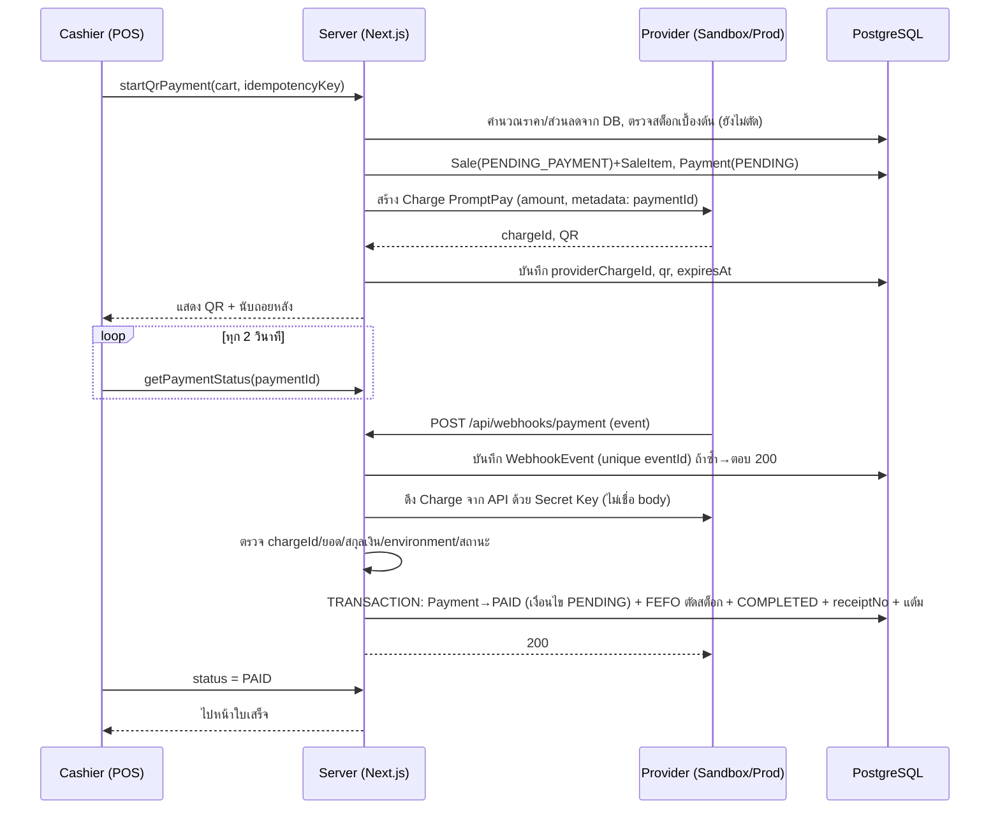

# SmartMart POS — แผนเสริม v2.1: PromptPay QR ผ่าน Payment Provider

> สถานะ: **รออนุมัติ — ยังไม่เขียนโค้ด**
> เอกสารนี้เป็น **ส่วนเสริม** ของ `SmartMart-POS-Plan-v2-FullFeatures.md` และ **แทนที่** ข้อความเกี่ยวกับ Payment, ตาราง Roadmap Day 5–10 และลำดับตัดของ v2 ส่วนอื่นยังใช้ตาม v2
> ข้อเท็จจริงของ Provider (ฟีเจอร์ sandbox, รูปแบบ webhook, ค่าธรรมเนียม) ในเอกสารนี้ **ยังไม่ได้ตรวจกับเอกสารจริงของผู้ให้บริการ** จึงกำหนด "Provider Spike" ไว้ใน Day 1 เพื่อยืนยันก่อนลงมือทำ

---

## 1. ผลกระทบต่อภาพรวม (พูดตรง ๆ)

| ประเด็น | ข้อเท็จจริง |
|---|---|
| ขอบเขตเพิ่ม | ไม่ใช่แค่ปุ่มจ่าย: ต้องมีสถานะการชำระเงิน, webhook, การตรวจยืนยันกับ Provider, สถานะ "บิลค้างจ่าย" และการเชื่อมกับ stock/FEFO/แต้ม |
| เวลาที่ต้องเพิ่ม | ประมาณ **15–18 ชั่วโมง (≈ 2 วันทำงาน)** ตามประเมินของผม |
| v2 เดิมมีเวลาสำรองหรือไม่ | **ไม่มี** (ทุกวันเต็ม) |
| ผลสรุป | เพิ่ม QR จริง + คงทุกโมดูลของ v2 ภายใน 10 วัน **ทำได้ก็ต่อเมื่อลดความลึกของโมดูล Priority 2 ลงอีกชั้นเป็นค่าตั้งต้น** (หัวข้อ 8) และต้องยอมรับว่าความเสี่ยงสูงขึ้น |
| เงินจริง | หากยังไม่มี Merchant/Production API ระบบนี้ **ทำงานกับ Sandbox เท่านั้น** (ไม่สามารถรับเงินจริงได้) ระบบต้องแสดงสถานะนี้ให้เห็นชัดเจน |
| ความเสี่ยงภายนอก | ผูกกับบริการของ Provider: ความล่าช้าของ sandbox, เงื่อนไขสมัครบัญชี, webhook ต้องมี URL สาธารณะ — ควบคุมไม่ได้ทั้งหมด |

---

## 2. การเลือก Provider (ต้องตัดสินใจก่อนเริ่ม)

ผมใช้สถาปัตยกรรมแบบ **Adapter** (`PaymentProvider` interface) เพื่อให้เปลี่ยน Provider ได้โดยแก้ไฟล์เดียว

| ตัวเลือก | หมายเหตุ (ยังไม่ยืนยัน) |
|---|---|
| **Opn Payments (เดิม Omise)** — ข้อเสนอเริ่มต้น | เจ้าของตลาดไทย มีเอกสาร API และโหมดทดสอบแยกด้วย test keys; PromptPay สร้างผ่าน Charge แบบ source `promptpay` |
| 2C2P / GB Prime Pay | เป็นไปได้ แต่ขั้นตอนสมัครอาจต้องติดต่อฝ่ายขาย ซึ่งไม่เหมาะกับกรอบ 10 วัน |
| Stripe | รองรับ PromptPay เฉพาะบัญชีที่เปิดในประเทศไทยตามที่ผมทราบ ซึ่งตรวจสอบให้แน่ใจก่อนใช้ |

**Provider Spike (Day 1, ≈ 2 ชม.):**
1. คุณสมัครบัญชีและรับ **Sandbox/Test keys** (คุณเป็นผู้ใส่ keys ลง `.env` เอง — ผมไม่ขอ keys ในแชต)
2. ผมอ่านเอกสาร API ปัจจุบันและยืนยัน: (ก) สร้าง Dynamic PromptPay QR ใน test mode ได้ไหม (ข) test mode จำลองการจ่ายอย่างไร (ค) รูปแบบ webhook และมี signature หรือไม่ (ง) QR หมดอายุกี่นาที (จ) หน่วยเงิน (สตางค์) (ฉ) มีการ cancel/refund PromptPay ผ่าน API หรือไม่
3. ผลลัพธ์ = บันทึกใน `docs/DECISIONS.md` **ถ้า spike ไม่ผ่านภายใน 2 ชม. → เปลี่ยน Provider หรือถอยเป็นทางเลือก QR แบบ A (หัวข้อ 10)**

---

## 3. สถานะและ Flow

### 3.1 สถานะ

- **Payment.status:** `PENDING → PAID | FAILED | EXPIRED` (ย้อนกลับไม่ได้ ยกเว้นกรณีจ่ายล่าช้า ดู 6.3)
- **Sale.status (เพิ่ม):** `PENDING_PAYMENT` (รอจ่าย), `CANCELLED` (หมดเวลา/ล้มเหลว/ยกเลิก), `PAID_NEEDS_REVIEW` (Provider ยืนยันจ่ายแล้วแต่ระบบทำรายการขายต่อไม่ได้ เช่น สต็อกหมดไปแล้ว) นอกเหนือจาก `COMPLETED`, `PARTIALLY_RETURNED`, `FULLY_RETURNED` เดิม

### 3.2 Flow ชำระด้วย QR



### 3.3 หลักการที่ตรึงไว้

1. **เปลี่ยนเป็น PAID ได้ทางเดียว:** ผ่านฟังก์ชัน `confirmPayment()` ที่ทำเมื่อ Provider API ยืนยันว่าสำเร็จ (ดึงเองจาก API) — ไม่มี endpoint/ปุ่มใดตั้ง PAID ตรง ๆ
2. **Webhook เป็นสัญญาณ ไม่ใช่ความจริง:** ความจริงคือคำตอบจาก Provider API ที่เรียกด้วย secret key (ป้องกันการปลอม webhook แม้ Provider ไม่มี signature)
3. **ยังไม่ตัดสต็อกจนกว่าจะ PAID:** ตามข้อกำหนด
4. **ราคา/ยอดมาจาก DB ตอนเริ่ม** และถูก lock ใน Sale ที่ PENDING; ยอดที่ Provider ยืนยันต้องเท่ากับ `Payment.amount` เป๊ะ
5. **Polling เป็น fallback:** ถ้า webhook ไม่มา (เช่น dev ไม่มี tunnel) `getPaymentStatus` เรียก `reconcile()` ที่ถาม Provider API แล้วใช้ `confirmPayment()` ตัวเดียวกัน (ไม่ใช่ทางลัดแบบปลอม และบันทึกว่าได้ผลจากช่องทางใด)

---

## 4. ฐานข้อมูล (ส่วนที่เปลี่ยนจาก v2)

```prisma
enum PaymentMethod { CASH PROMPTPAY }
enum PaymentStatus { PENDING PAID FAILED EXPIRED }
enum PaymentEnv    { SANDBOX PRODUCTION }
enum SaleStatus {
  PENDING_PAYMENT
  COMPLETED
  PARTIALLY_RETURNED
  FULLY_RETURNED
  CANCELLED
  PAID_NEEDS_REVIEW
}

model Sale {
  // ... ฟิลด์เดิมจาก v2 ยกเว้น:
  receiptNo      String?  @unique        // ออกเมื่อสถานะเป็น COMPLETED เท่านั้น
  status         SaleStatus @default(COMPLETED)
  paymentMethod  PaymentMethod
  amountPaid     Decimal  @default(0) @db.Decimal(12, 2)
  changeAmount   Decimal  @default(0) @db.Decimal(12, 2)
  payment        Payment?                // 1:1
}

model Payment {
  id                String        @id @default(uuid()) @db.Uuid
  saleId            String        @unique @db.Uuid   // 1:1 กับ Sale
  method            PaymentMethod
  status            PaymentStatus @default(PENDING)
  environment       PaymentEnv                         // บันทึกเสมอ แยก sandbox/production
  provider          String?                            // 'opn' ฯลฯ (null สำหรับเงินสด)
  providerChargeId  String?       @unique
  amount            Decimal       @db.Decimal(12, 2)
  currency          String        @default("THB")
  qrImageUrl        String?
  expiresAt         DateTime?
  paidAt            DateTime?
  confirmedVia      String?                            // 'webhook' | 'reconcile'
  failureReason     String?
  createdAt         DateTime      @default(now())
  updatedAt         DateTime      @updatedAt

  sale          Sale           @relation(fields: [saleId], references: [id], onDelete: Restrict)
  webhookEvents WebhookEvent[]

  @@index([status, expiresAt])
}

model WebhookEvent {
  id              String   @id @default(uuid()) @db.Uuid
  provider        String
  providerEventId String   @unique        // กัน webhook ซ้ำ
  eventType       String
  paymentId       String?  @db.Uuid
  payload         Json
  outcome         String?                  // 'CONFIRMED' | 'IGNORED_DUPLICATE' | 'REJECTED_AMOUNT' | ...
  receivedAt      DateTime @default(now())
  processedAt     DateTime?

  payment Payment? @relation(fields: [paymentId], references: [id], onDelete: SetNull)

  @@index([paymentId])
}
```

**CHECK ที่ต้องแก้:** `sale_paid_enough` เป็นแบบมีเงื่อนไข
```sql
ALTER TABLE "Sale" ADD CONSTRAINT sale_paid_enough
  CHECK (status IN ('PENDING_PAYMENT','CANCELLED') OR "amountPaid" >= "total");
```
**ผลต่อโมดูลอื่น:** รายงาน/แดชบอร์ด/BI/แต้ม/Return นับเฉพาะบิล `COMPLETED`/`*_RETURNED`; การกรอง "บิลที่นับ" ต้องผ่านฟังก์ชันกลางเดียว (`countableSales`) ห้ามเขียน where ซ้ำหลายที่

---

## 5. Environment และความปลอดภัย

| ข้อกำหนด | วิธีทำ |
|---|---|
| แยก Sandbox/Production | `PAYMENT_ENV=sandbox\|production` + ชุด key แยก (`OPN_SANDBOX_*`, `OPN_LIVE_*`) ไม่มี key ชุดเดียวใช้ปน |
| กัน key ผิดสภาพแวดล้อม | ตอนบูต: ถ้า `PAYMENT_ENV=sandbox` แต่ key เป็น live (หรือกลับกัน) → throw ไม่ให้ทำงาน; Vercel Preview/Dev ใช้ sandbox เท่านั้น |
| Secrets | อยู่ใน env vars เท่านั้น; ไม่ส่งถึง client; ไม่ log; `.env*` ไม่ถูก commit |
| แสดงว่าเป็น Sandbox | แถบ "SANDBOX — ไม่ใช่เงินจริง" บนหน้า QR, ใบเสร็จ, รายการขาย และ Dashboard (อ่านจาก `Payment.environment`) |
| ห้ามจำลองการจ่ายโดยไม่ระบุ | ไม่มีปุ่ม/endpoint "จำลองจ่ายสำเร็จ" ในแอป; การทดสอบ sandbox ใช้กลไกของ Provider เอง (ผ่านเส้นทาง webhook จริง); test double (`FakeProvider`) อยู่ในโฟลเดอร์ test เท่านั้นและตั้งชื่อชัดเจน |
| Webhook endpoint | Route Handler `/api/webhooks/payment` (ไม่ใช้ session), อ่าน raw body, ตรวจ signature ถ้า Provider มี, ตรวจซ้ำด้วยการดึง Charge จาก API, rate limit เบื้องต้น, ตอบ 2xx เมื่อประมวลผลสำเร็จ/ซ้ำ และ 5xx เมื่อผิดพลาดชั่วคราวเพื่อให้ Provider ส่งซ้ำ |
| สิทธิ์ | เริ่มจ่าย QR: ADMIN/CASHIER; ดู/ยกเลิก payment ของตนเอง; ADMIN เห็นทั้งหมด |
| URL สำหรับ Webhook | dev: ต้องใช้ tunnel (เช่น cloudflared/ngrok — เครื่องมือเพิ่ม) หรือใช้ URL ของ Vercel Preview; prod: URL โดเมนจริง |

---

## 6. อัลกอริทึมสำคัญ

### 6.1 `startQrPayment`
Zod → ตรวจ role → idempotency key (ซ้ำ = คืน Payment เดิม) → `pricing.calculate` จาก DB → ตรวจว่าสต็อกที่ขายได้พอ (soft check, **ไม่ตัด/ไม่จอง**) → transaction: สร้าง Sale(PENDING_PAYMENT)+SaleItem(+ส่วนลด)+Payment(PENDING, environment) → เรียก Provider สร้าง Charge (amount เป็นสตางค์จาก Decimal, `metadata.paymentId`) → บันทึก `providerChargeId`, QR, `expiresAt` → ถ้า Provider ล้มเหลว: Payment=FAILED, Sale=CANCELLED (ไม่ทิ้งบิลค้าง)

### 6.2 `confirmPayment(paymentId, source)` — เรียกได้จาก webhook และ reconcile เท่านั้น
1. ดึง Charge จาก Provider API → ต้องเป็นสำเร็จ, `chargeId` ตรงกับ `providerChargeId`, ยอดเท่ากับ `Payment.amount`, สกุล THB, โหมด (live/test) ตรงกับ `Payment.environment` — ไม่ตรงข้อใดข้อหนึ่ง = ไม่เปลี่ยนสถานะ + บันทึก outcome `REJECTED_*` + แจ้ง ADMIN
2. transaction:
   - `updateMany Payment SET status=PAID, paidAt WHERE id AND status=PENDING` → ถ้า count=0 แสดงว่ามีผู้ทำแล้ว → ออก (ไม่ตัดสต็อกซ้ำ)
   - ถ้า Sale ยัง `PENDING_PAYMENT`: `allocateFefo` ตัดสต็อก, สร้าง SaleItemBatch/StockMovement, ออก `receiptNo`, ให้แต้ม, Sale=COMPLETED
   - ถ้าสต็อกไม่พอ (ขายหมดระหว่างรอ): Payment=PAID, Sale=`PAID_NEEDS_REVIEW`, สร้าง Notification ถึง ADMIN เพื่อคืนเงินด้วยตนเอง **ห้ามเงียบ**
3. ทั้งหมดอยู่ใน transaction เดียว → ล้มเหลว = rollback ทั้งหมด (Payment ยัง PENDING, webhook ถูกส่งซ้ำได้)

### 6.3 หมดเวลา/ล้มเหลว/จ่ายล่าช้า
- `expireIfDue()` ถูกเรียกแบบ lazy (เมื่อ poll, เมื่อเปิดหน้ารายการ, ตอนเริ่มบิลใหม่) **ถามสถานะจาก Provider ก่อนเสมอ** แล้วจึงตั้ง EXPIRED/FAILED + Sale=CANCELLED
- ถ้า Provider รายงานว่า "จ่ายสำเร็จ" ภายหลังหมดเวลา: ลองทำ `confirmPayment` ตามปกติ (ถ้าสต็อกพอ ก็เป็น COMPLETED; ไม่พอ → `PAID_NEEDS_REVIEW`)
- ยกเลิกโดยแคชเชียร์: อนุญาตเมื่อ Provider ยืนยันว่ายังไม่จ่าย

### 6.4 Return/Refund ของบิลที่จ่ายด้วย QR
**ไม่เรียก API คืนเงินของ Provider** (นอกขอบเขต) ระบบบันทึกการคืนสินค้า/สต็อก/แต้มตามปกติ และบันทึก "คืนเงินด้วยตนเอง (โอนคืนนอกระบบ)" พร้อมหมายเหตุ ใบคืนเงินระบุชัด — นี่คือข้อจำกัดที่ต้องบอกในการนำเสนอ

---

## 7. UI ที่เพิ่ม
- **PaymentDialog:** แท็บ "เงินสด" / "PromptPay QR"
- **หน้าจอ QR:** รูป QR, ยอด, นับถอยหลัง, สถานะ (กำลังรอ/สำเร็จ/ล้มเหลว/หมดเวลา), ปุ่มยกเลิก/สร้างใหม่, แถบ SANDBOX; สำเร็จแล้วพาไปใบเสร็จอัตโนมัติ
- **Sales History:** คอลัมน์วิธีชำระ + ตัวกรองสถานะ (รวมบิลค้างจ่าย/ยกเลิก/ต้องตรวจสอบ) + ป้าย SANDBOX
- **Settings (ADMIN):** แสดงสถานะ Provider (sandbox/production) อ่านอย่างเดียว ไม่มีช่องกรอก key
- **รายงาน:** แยกยอดเงินสด/QR, นับเฉพาะบิลที่ COMPLETED

## 8. Roadmap v2.1 (Day 1–10) และสิ่งที่ต้องลดความลึก

**ประเมินเพิ่ม QR ≈ 16 ชม.**: Spike 2 + schema/state 2 + start/QR UI/polling 4.5 + webhook/confirm/idempotency 4 + expiry/fail/late/review 2 + test 2.5 (รวม deploy webhook ค่ายอยู่ใน Day 10)

| วัน | งาน | หมายเหตุ |
|---|---|---|
| 1 | Foundation + Schema (รวม Payment/WebhookEvent/สถานะใหม่) + Seed + deploy skeleton + **Provider Spike** | |
| 2 | Auth + Layout + Users + `audit()` | เหมือน v2 |
| 3 | Category + Product + batch เริ่มต้น | เหมือน v2 |
| 4 | Inventory/Batch + FEFO service + test | เหมือน v2 (ลด notification เหลือ low-stock/หมดอายุ) |
| 5 | POS + **Checkout เงินสด** + Receipt + Sales History พื้นฐาน | Priority 1 เสร็จ; Payment ใช้ตารางใหม่ตั้งแต่เงินสด |
| 6 | **PromptPay QR (เต็มวัน)**: start → QR → webhook → confirm → expiry → test | ความเสี่ยงสูง ทำก่อน Promotion |
| 7 | Promotion (PRODUCT+BILL) + Member + Loyalty (Earn) | ควบรวมวันเดียว |
| 8 | Return/Refund + Notification (in-app 2–4 ชนิด) + Audit หน้าดูแบบเรียบ + Sales detail | |
| 9 | Reports/Dashboard/Smart BI (ฉบับย่อ) **ครึ่งเช้า** + integration test + แก้บั๊ก | ลดเวลาทดสอบ ← ความเสี่ยง |
| 10 | Deploy (ตั้ง webhook URL ที่ Provider, env คนละชุด) + ตรวจ prod/sandbox + demo + ซ้อม | |

**ค่าตั้งต้นที่ลดลง (เดิมเป็นแผนสำรอง ตอนนี้เป็น baseline):**
1. Loyalty **Redeem ตัดทิ้ง** (เหลือ Earn)
2. Return: ไม่รองรับบิลที่ใช้แต้ม, ไม่มี `restock=false`, ไม่พิมพ์ใบคืนเงิน
3. Notification: 2–4 ชนิด ไม่มีหน้าแยกซับซ้อน
4. Audit: บันทึกครบ หน้าดูแบบตารางเรียบ
5. Smart BI: **3–4 กฎ**
6. Promotion: PRODUCT + BILL (ตัด CATEGORY)
7. Reports: ยอดรายวัน/ขายดี/ขายช้า/แยกวิธีชำระ; ไม่มี Export
8. ไม่มีการจองสต็อกระหว่างรอ QR (ตรวจเบื้องต้นตอนเริ่ม + ตรวจจริงตอน PAID ถ้าไม่พอ → `PAID_NEEDS_REVIEW`)

**หลังจากนี้ไม่มีแผนสำรองที่ตัดแบบไม่เจ็บแล้ว** หากยังช้าอีก ต้องตัดโมดูลทั้งก้อน เสนอลำดับ: (1) Return → "ยกเลิกบิลทั้งใบ", (2) Promotion, (3) Member/Loyalty, (4) QR → ทางเลือก A (หัวข้อ 10)

**Checkpoint บังคับ:**
- จบ Day 5: Priority 1 ผ่าน
- จบ Day 6: QR ผ่านเคสทดสอบ sandbox จริง 1 รอบครบ (สร้าง→จ่าย→webhook→ตัดสต็อก→ใบเสร็จ) ถ้าไม่ผ่านภายใน Day 6 → หยุด ตัดสินใจกับคุณ (ถอยเป็นทางเลือก A หรือตัด Priority 2 เพิ่ม)

## 9. Testing เฉพาะ QR
อัตโนมัติ (ใช้ `FakeProvider` ใน test เท่านั้น): webhook ซ้ำ 2 ครั้ง → ตัดสต็อกครั้งเดียว · webhook 2 ตัวพร้อมกัน (`Promise.all`) → PAID ครั้งเดียว · ยอดไม่ตรง → ไม่ PAID · Charge id ไม่ตรง → ไม่ PAID · environment ไม่ตรง → ไม่ PAID · Provider ตอบ "ยังไม่จ่าย" แต่ webhook อ้างว่าจ่าย → ไม่ PAID · FAILED/EXPIRED → Sale CANCELLED ไม่ตัดสต็อก · จ่ายล่าช้าสต็อกพอ/ไม่พอ · ล้มเหลวกลาง transaction → rollback แล้ว webhook ซ้ำสำเร็จ
ด้วยมือบน **Sandbox จริง**: จ่ายสำเร็จ, หมดเวลา, ยกเลิก, ปิดแท็บระหว่างรอแล้วเปิดใหม่, webhook ไม่มา (พึ่ง reconcile), ตรวจบน Vercel จริงด้วย URL สาธารณะ
`verify-integrity` เพิ่ม: Payment PAID ทุกรายการมี Sale COMPLETED หรือ PAID_NEEDS_REVIEW · ไม่มี Sale PENDING_PAYMENT ที่เก่ากว่าเวลาหมดอายุ+ช่วงผ่อนผันโดยไม่มีเหตุผล · `Σ` ยอด QR ที่ PAID ตรงกับรายงาน

## 10. ข้อจำกัดที่ต้องเปิดเผย (ใช้ในการนำเสนอ)
1. ทดสอบกับ **Sandbox** เท่านั้นจนกว่าจะมี Merchant/Production API — ยังไม่รับเงินจริง
2. ไม่จองสต็อกระหว่างรอ QR (กรณีขายหมดแล้วลูกค้าจ่ายแล้ว → ต้องคืนเงินด้วยตนเอง)
3. การคืนเงินบิล QR ไม่ผ่าน Provider
4. ไม่รองรับบัตร/E-Wallet/ช่องทางอื่น และไม่มี split payment
5. เสถียรภาพขึ้นกับ Provider/Webhook และ cold start ของ Neon/Vercel
6. Reconcile เป็น fallback ไม่ใช่ background job (ไม่มี cron): บิลที่ไม่มีใครเปิดดูจะถูกตัดสถานะเมื่อมีการเข้าถึงครั้งถัดไป

**ทางเลือก A (ถอยกลับ):** แสดง PromptPay QR ที่สร้างเองพร้อมยอด แล้วแคชเชียร์กดยืนยันเอง — ไม่ใช่การยืนยันจาก Provider จึงต้องตั้งชื่อเป็น "โอนผ่าน QR (ยืนยันโดยแคชเชียร์)" และไม่ใช้สถานะ PAID อัตโนมัติ ใช้เมื่อ Spike/Day 6 ไม่ผ่านเท่านั้น

## 11. สิ่งที่ต้องตัดสินใจ/เตรียมก่อนเริ่ม
1. ยืนยัน Provider (ข้อเสนอ: Opn Payments) และคุณสมัครบัญชีเพื่อรับ **test keys** ก่อน Day 1
2. คุณมี/ตั้งใจจะมี Merchant account ที่เปิด Production ได้หรือไม่ (ถ้าไม่ → Sandbox ตลอดโครงการ ระบุในงานนำเสนอ)
3. เครื่องมือ tunnel สำหรับ webhook ตอนพัฒนา (cloudflared หรือ ngrok) หรือจะทดสอบ webhook บน Vercel Preview เท่านั้น
4. ยอมรับ baseline ที่ลดลงในหัวข้อ 8 และข้อจำกัดในหัวข้อ 10
5. รอบคำถามเดิมที่ยังค้างจาก v2 (หมดอายุ, อัตราแต้ม, โปรโมชั่น, สิทธิ์ CASHIER, พ.ศ./ค.ศ., ชื่อร้าน, วันเริ่ม–ส่ง)

**จุดหยุด:** รอการอนุมัติก่อนเริ่ม Day 1
