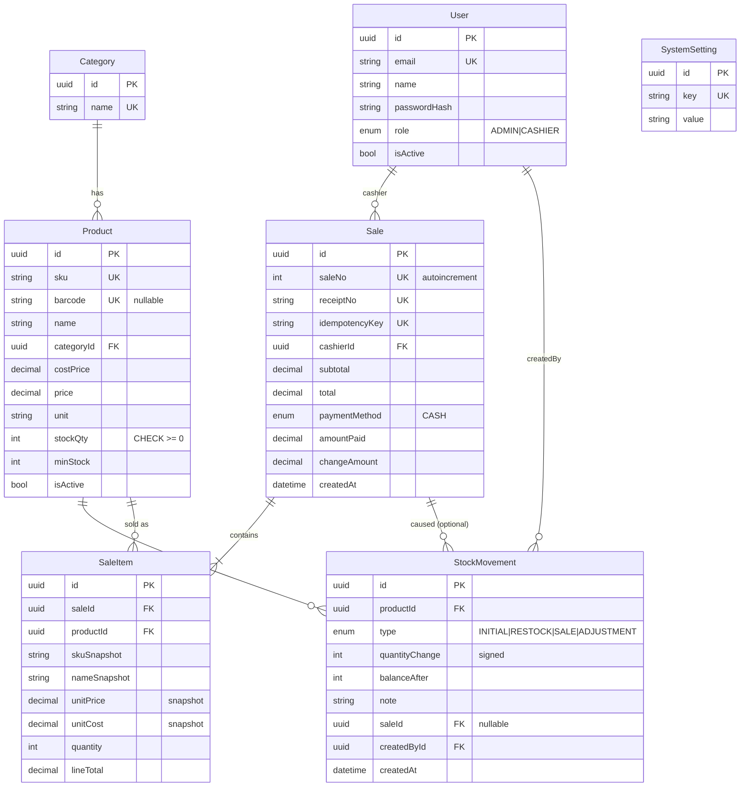

# SmartMart POS — การประเมินโครงการใหม่และแผนพัฒนา 10 วัน

> สถานะ: **รออนุมัติ** — ยังไม่มีการเขียนโค้ดแอปพลิเคชันใด ๆ
> หมายเหตุ: ตัวเลขเวอร์ชันแพ็กเกจในเอกสารนี้ยังไม่ได้ตรวจกับ registry จริง ให้ยืนยันและ pin เวอร์ชันในวันที่ 1

---

## PART 1 — การประเมินโครงการ

### 1.1 ความเป็นไปได้

**ทำได้ — แต่ทำได้เมื่อยึดขอบเขตที่ปรับลดแล้วเท่านั้น** ข้อกำหนดเดิมมี 11 หน้า + Dashboard + BI + Auth/Role ซึ่งสำหรับคนเดียว (ระดับเริ่มต้น–ปานกลาง) + Claude Code ใน 10 วัน ถือว่า "ตึงแต่ไม่เกินไป" ถ้า:

1. ทำ **vertical slice ของการขาย (POS → Checkout → ตัดสต็อก → ใบเสร็จ) ให้เสร็จก่อนวันที่ 4**
2. ใช้ shadcn/ui ประกอบหน้าแทนการออกแบบเอง
3. หน้าที่ไม่กระทบกระบวนการขาย (Settings, User Management, BI) ทำแบบเรียบที่สุด และเป็นกลุ่มแรกที่ถูกตัด
4. Deploy ตั้งแต่วันที่ 1 (ไม่รอวันสุดท้าย)

### 1.2 ข้อกำหนดที่ขัดแย้ง/มีปัญหา และข้อเสนอของผม

| # | ประเด็น | ปัญหา | ข้อเสนอ |
|---|---|---|---|
| 1 | แผนเดิมวันที่ 6 ทำ Checkout | ขัดกับกฎ "ห้ามเลื่อน Checkout ไปท้าย ๆ" และเสี่ยงสูงสุดของระบบ | **ย้าย Checkout ไปวันที่ 3** (หลังมี Product + Auth) |
| 2 | Inventory แยกตาราง | ร้านเดียว → ตารางแยกเพิ่ม join/ความซับซ้อน แต่ไม่ได้ประโยชน์ | **ยุบเป็น `Product.stockQty`** + `StockMovement` เป็นบัญชีแยกประเภท (ขยายหลายสาขาภายหลังโดยสร้าง `Inventory(branchId, productId)` แล้วย้ายคอลัมน์) |
| 3 | Payment แยกตาราง | รองรับเงินสดอย่างเดียว/ห้าม Split Payment → 1 บิล = 1 การชำระ | **ยุบเข้า `Sale`** (`paymentMethod`, `amountPaid`, `changeAmount`) |
| 4 | Auth.js | v5 ยังเป็น beta ในหลายช่วงเวลา, มีปัญหา edge/Prisma adapter บ่อย, ใช้แค่ credentials login | **ใช้ session cookie เอง**: `jose` (JWT เซ็นชื่อ, HttpOnly, Secure, SameSite=Lax) + `bcryptjs` ~100 บรรทัด ควบคุมได้ ดีบักง่าย |
| 5 | "ลบหมวดหมู่เมื่อไม่มีข้อมูลที่เกี่ยวข้อง" | ต้องกัน FK | `onDelete: Restrict` + แสดงข้อความภาษาไทยเมื่อลบไม่ได้ |
| 6 | Smart BI "วิเคราะห์แนวโน้ม" | ขอบเขตกว้างได้ไม่สิ้นสุด | จำกัดเป็น **6 กฎคงที่** (ดู 2.3) ทุกกฎอธิบายสูตรได้ |
| 7 | Reports vs Dashboard ซ้ำกัน | กราฟ/ตัวเลขซ้ำ | ใช้ **query/service ชุดเดียวกัน** ใช้ซ้ำสองหน้า |
| 8 | Barcode ซ้ำเมื่อระบุค่า | สตริงว่างจะซ้ำกัน | Zod แปลง `""` → `null`; Postgres อนุญาต NULL ซ้ำใน unique |
| 9 | Print receipt | PDF/ESC-POS ใช้เวลามาก | ใช้ `window.print()` + CSS `@media print` ขนาด 80mm |
| 10 | Timezone | Vercel รันเป็น UTC → "ยอดขายวันนี้" ผิดช่วง 00:00–07:00 | เก็บ UTC, **คำนวณ "วัน" ด้วย `Asia/Bangkok` เสมอ** (ฟังก์ชันกลางตัวเดียว) |
| 11 | "Inventory ห้ามติดลบ" + "Checkout พร้อมกัน" | race condition | `UPDATE … WHERE stockQty >= n` แบบ atomic + CHECK constraint ใน DB |

### 1.3 ฟีเจอร์ที่ใช้เวลามากเกินสมควร (ระวัง)

- CRUD สินค้า (ฟอร์ม+ตาราง+ค้นหา+validation) — วันที่ 2 หนักสุดคู่กับ Auth
- POS UI (ค้นหา, ตะกร้า, คีย์ลัด, สแกนบาร์โค้ด) — วันที่ 3
- กราฟ Recharts + query รวมข้อมูลตามวัน (เรื่อง timezone)
- Responsive tablet ของ POS

### 1.4 ความเสี่ยงทางเทคนิค

| ความเสี่ยง | ผลกระทบ | แผนลดความเสี่ยง |
|---|---|---|
| ชนกันของเวอร์ชัน (Next/React/Tailwind v4/shadcn/Prisma) | เสียเวลาครึ่งวัน | ใช้ค่าเริ่มต้นของ `create-next-app` + `shadcn init` ล่าสุด, pin เวอร์ชัน, **ห้ามอัปเกรดระหว่างโครงการ**; Prisma ใช้ 6.x |
| Neon: connection pooling กับ migrate | migrate ค้าง/ล้มเหลว | ใช้ `DATABASE_URL` (pooled) สำหรับแอป และ `DIRECT_URL` สำหรับ migrate |
| Neon cold start (free tier หลับ) | หน้าแรกช้าตอน demo | เปิดระบบ 5 นาทีก่อนสาธิต / ping ก่อน |
| Checkout ซ้ำ/พร้อมกัน/สต็อกติดลบ | ข้อมูลผิด | idempotency key + transaction + conditional update (Part 3) |
| Server Actions ไม่ตรวจสิทธิ์ (Middleware อย่างเดียวไม่พอ) | ช่องโหว่ | `requireRole()` เรียก**ภายในทุก action/page** |
| Prisma `Decimal` serialize ไป Client Component ไม่ได้ | error ตอน build | แปลงเป็น `string/number` ที่ชั้น service ก่อนส่งให้ UI |
| Claude Code สร้างโค้ดมากเกินแล้วพัง | ย้อนยาก | commit ทุก slice เล็ก, tag ทุกสิ้นวัน |
| Vercel function timeout/ DB region ห่าง | ช้า | เลือก region Neon = Singapore, Vercel function region = `sin1` |

### 1.5 สถาปัตยกรรมที่แนะนำ (ขั้นต่ำ)

```
Browser ──► Next.js (App Router, Vercel)
              ├─ Server Components  → อ่านข้อมูลผ่าน services
              ├─ Server Actions     → เขียนข้อมูล (Zod validate → requireRole → service)
              ├─ middleware.ts      → redirect หน้าที่ไม่ล็อกอิน (ด่านแรกเท่านั้น)
              └─ src/server/services/* → business logic + Prisma  (ที่เดียวที่แตะ DB)
                       │
                       ▼
                 Neon PostgreSQL (Prisma 6)
```

โครงสร้างโฟลเดอร์:

```
src/
  app/
    (auth)/login/
    (app)/                  # layout มี Sidebar+Topbar, ตรวจ session
      dashboard/ pos/ products/ categories/ inventory/
      sales/ sales/[id]/ receipt/[id]/ reports/ users/ settings/
  components/ui/            # shadcn
  components/{layout,pos,charts,shared}/
  server/
    auth/ (session.ts, guard.ts)
    services/ (checkout.ts, products.ts, inventory.ts, reports.ts, bi.ts, ...)
    db.ts                   # Prisma singleton
  lib/ (money.ts, date.ts, validators/*.ts, utils.ts)
prisma/ (schema.prisma, migrations/, seed.ts)
docs/ (PLAN.md, DECISIONS.md, TEST-CHECKLIST.md)
CLAUDE.md
```

หลักการ: **หน้า/Action บาง — logic อยู่ใน `server/services`** เพื่อให้ Claude Code แก้เป็นชิ้น ๆ และทดสอบ checkout แยกได้

ไม่ใช้: tRPC, Redux/Zustand (ตะกร้าใช้ `useReducer` + localStorage), React Query, Docker, ORM เพิ่มเติม, i18n library (ฮาร์ดโค้ดภาษาไทย)

---

## PART 2 — ขอบเขต MVP ฉบับสุดท้าย

### 2.1 ต้องมี (Must)

| กลุ่ม | รายการ |
|---|---|
| Auth | Login/Logout, bcrypt, ADMIN/CASHIER, guard ฝั่ง server |
| Product | เพิ่ม/แก้ไข/ปิดใช้งาน/ค้นหา, SKU, Barcode, หมวด, ทุน, ขาย, หน่วย, min stock |
| Category | เพิ่ม/แก้ไข/ลบ (ถ้าไม่มีสินค้า)/ค้นหา |
| Inventory | ดูคงเหลือ, ปรับสต็อก (+/−/ตั้งค่า พร้อมเหตุผล), ประวัติเคลื่อนไหว, ป้ายสินค้าใกล้หมด |
| POS | ค้นหา/สแกน SKU-Barcode, ตะกร้า, +/−/ลบ, subtotal/total, ตรวจสต็อกก่อนขาย |
| Payment | เงินสด, รับเงิน, เงินทอน, ยืนยัน |
| Receipt | เลขใบเสร็จไม่ซ้ำ, รายการ, พิมพ์ได้ |
| Sales History | รายการ, ค้นด้วยเลขใบเสร็จ, กรองวันที่, ดูรายละเอียด |
| Dashboard | ยอดวันนี้, จำนวนบิล, จำนวนสินค้า, สินค้าใกล้หมด, กราฟยอดขาย, สินค้าขายดี |
| Reports | ยอดรายวัน, จำนวนบิล, ค่าเฉลี่ยต่อบิล, ขายดี, กราฟ |

### 2.2 ฟีเจอร์เสริม (Should — ทำถ้าตามแผน)

- Smart BI (6 กฎ) — **ถือเป็น Must สำหรับการสาธิต** แต่ทำแบบเรียบ
- User Management (ADMIN เพิ่ม/ปิดผู้ใช้/รีเซ็ตรหัส)
- Settings (ชื่อร้าน, ที่อยู่, เบอร์, ข้อความท้ายใบเสร็จ)
- คีย์ลัดใน POS (F2 โฟกัสค้นหา, Enter ยืนยัน), ปุ่มเงินสดด่วน (100/500/1000/พอดี)
- Export CSV รายงาน

### 2.3 Smart BI — กฎที่กำหนด (Rule-based statistics, ไม่ใช่ Generative AI)

| # | Insight | วิธีคำนวณ |
|---|---|---|
| 1 | สินค้าขายดี 7/30 วัน | `SUM(quantity)` จัดอันดับ |
| 2 | สินค้าควรสั่งเพิ่ม | `daysOfCover = stockQty / avgDailySales(14วัน)`; แจ้งเมื่อ < 7 วัน หรือ stock ≤ minStock |
| 3 | ยอดวันนี้ vs เมื่อวาน | % เปลี่ยนแปลง + ข้อความ |
| 4 | แนวโน้ม 7 วัน | ความชัน linear regression ของยอดขายรายวัน → "เพิ่มขึ้น/ทรงตัว/ลดลง" (เกณฑ์ ±5% ของค่าเฉลี่ย) |
| 5 | สินค้าขายช้า | ไม่มีการขายใน 14 วันแต่มีสต็อก |
| 6 | สินค้ากำไรสูงสุด | `(price − cost) × qty` |

UI ต้องมีป้าย "วิเคราะห์ด้วยสถิติและกฎที่กำหนด — ไม่ใช้ AI สร้างข้อความ" และแสดงสูตรเมื่อกด "ดูวิธีคำนวณ" เพื่อแยกจาก Generative AI ชัดเจน

### 2.4 ตัดออก (Excluded) + ลำดับที่ตัดก่อนเมื่อเวลาไม่พอ

ตัดตามข้อกำหนดเดิมทั้งหมด (หลายสาขา, สมาชิก, โปรโมชั่น, ซัพพลายเออร์, PO, คืนสินค้า, ล็อต/FEFO, Split Payment, Offline, External AI, Forecast ขั้นสูง, Notification, Gateway, Audit Log ขั้นสูง) และเพิ่ม: ส่วนลด, ภาษี VAT แยกบรรทัด, ยกเลิกบิล (void), อัปโหลดรูปสินค้า, Dark mode

**ลำดับตัดเมื่อล่าช้า (ตัดจากบนลงล่าง):**
1. Export CSV, คีย์ลัดพิเศษ
2. หน้า Settings → ฮาร์ดโค้ดข้อมูลร้านใน `lib/store-info.ts`
3. User Management → ใช้ผู้ใช้จาก seed (เพิ่มผ่าน seed script)
4. Smart BI ลดเหลือ 3 กฎ (1, 2, 3)
5. Reports → ใช้ Dashboard + ตารางรายวัน (ไม่ทำหน้าแยก)
6. ค้นหา/กรองหมวดหมู่ → ตารางธรรมดา

**ห้ามตัด:** Auth, Product, Inventory adjust, POS, Checkout, Receipt, Sales History, Dashboard พื้นฐาน

---

## PART 3 — การออกแบบฐานข้อมูล

### 3.1 ER Diagram



### 3.2 Prisma Schema ฉบับสมบูรณ์

```prisma
generator client {
  provider = "prisma-client-js"
}

datasource db {
  provider  = "postgresql"
  url       = env("DATABASE_URL") // pooled (ใช้ตอนรันแอป)
  directUrl = env("DIRECT_URL")   // direct (ใช้ตอน migrate)
}

enum Role {
  ADMIN
  CASHIER
}

enum StockMovementType {
  INITIAL     // ยอดยกมา (seed / สร้างสินค้า)
  RESTOCK     // รับสินค้าเข้า (ปรับเพิ่ม)
  SALE        // ตัดจากการขาย
  ADJUSTMENT  // ปรับยอด (นับสต็อก/เสียหาย)
}

enum PaymentMethod {
  CASH
}

model User {
  id           String   @id @default(uuid()) @db.Uuid
  email        String   @unique
  name         String
  passwordHash String
  role         Role     @default(CASHIER)
  isActive     Boolean  @default(true)
  createdAt    DateTime @default(now())
  updatedAt    DateTime @updatedAt

  sales          Sale[]
  stockMovements StockMovement[]
}

model Category {
  id          String   @id @default(uuid()) @db.Uuid
  name        String   @unique
  description String?
  createdAt   DateTime @default(now())
  updatedAt   DateTime @updatedAt

  products Product[]
}

model Product {
  id         String   @id @default(uuid()) @db.Uuid
  sku        String   @unique
  barcode    String?  @unique
  name       String
  categoryId String   @db.Uuid
  costPrice  Decimal  @db.Decimal(12, 2)
  price      Decimal  @db.Decimal(12, 2)
  unit       String   @default("ชิ้น")
  stockQty   Int      @default(0)
  minStock   Int      @default(0)
  isActive   Boolean  @default(true)
  createdAt  DateTime @default(now())
  updatedAt  DateTime @updatedAt

  category       Category        @relation(fields: [categoryId], references: [id], onDelete: Restrict)
  stockMovements StockMovement[]
  saleItems      SaleItem[]

  @@index([categoryId])
  @@index([name])
  @@index([isActive])
}

model StockMovement {
  id             String            @id @default(uuid()) @db.Uuid
  productId      String            @db.Uuid
  type           StockMovementType
  quantityChange Int               // บวก = เข้า, ลบ = ออก
  balanceAfter   Int
  note           String?
  saleId         String?           @db.Uuid
  createdById    String            @db.Uuid
  createdAt      DateTime          @default(now())

  product   Product @relation(fields: [productId], references: [id], onDelete: Restrict)
  sale      Sale?   @relation(fields: [saleId], references: [id], onDelete: Restrict)
  createdBy User    @relation(fields: [createdById], references: [id], onDelete: Restrict)

  @@index([productId, createdAt])
  @@index([saleId])
}

model Sale {
  id             String        @id @default(uuid()) @db.Uuid
  saleNo         Int           @unique @default(autoincrement())
  receiptNo      String        @unique // เช่น SM-20261101-0001 สร้างจาก saleNo
  idempotencyKey String        @unique // UUID จาก client ต่อ 1 ตะกร้า
  cashierId      String        @db.Uuid
  subtotal       Decimal       @db.Decimal(12, 2)
  total          Decimal       @db.Decimal(12, 2)
  paymentMethod  PaymentMethod @default(CASH)
  amountPaid     Decimal       @db.Decimal(12, 2)
  changeAmount   Decimal       @db.Decimal(12, 2)
  createdAt      DateTime      @default(now())

  cashier        User            @relation(fields: [cashierId], references: [id], onDelete: Restrict)
  items          SaleItem[]
  stockMovements StockMovement[]

  @@index([createdAt])
  @@index([cashierId])
}

model SaleItem {
  id          String  @id @default(uuid()) @db.Uuid
  saleId      String  @db.Uuid
  productId   String  @db.Uuid
  skuSnapshot  String
  nameSnapshot String
  unitPrice    Decimal @db.Decimal(12, 2) // ราคา ณ ตอนขาย
  unitCost     Decimal @db.Decimal(12, 2) // ทุน ณ ตอนขาย (ใช้คำนวณกำไรย้อนหลัง)
  quantity     Int
  lineTotal    Decimal @db.Decimal(12, 2)

  sale    Sale    @relation(fields: [saleId], references: [id], onDelete: Cascade)
  product Product @relation(fields: [productId], references: [id], onDelete: Restrict)

  @@index([saleId])
  @@index([productId])
}

model SystemSetting {
  id        String   @id @default(uuid()) @db.Uuid
  key       String   @unique
  value     String
  updatedAt DateTime @updatedAt
}
```

**SQL เพิ่มใน migration (Prisma ไม่รองรับ CHECK):** สร้างด้วย `prisma migrate dev --create-only` แล้วแก้ไฟล์ก่อน apply

```sql
ALTER TABLE "Product"  ADD CONSTRAINT product_stock_nonneg CHECK ("stockQty" >= 0);
ALTER TABLE "Product"  ADD CONSTRAINT product_price_nonneg CHECK ("price" >= 0 AND "costPrice" >= 0);
ALTER TABLE "SaleItem" ADD CONSTRAINT saleitem_qty_pos CHECK ("quantity" > 0);
ALTER TABLE "Sale"     ADD CONSTRAINT sale_paid_enough CHECK ("amountPaid" >= "total");
```

### 3.3 คำอธิบายความสัมพันธ์และการลบ

| ความสัมพันธ์ | ชนิด | onDelete | เหตุผล |
|---|---|---|---|
| Category → Product | 1:N | **Restrict** | ลบหมวดที่มีสินค้าไม่ได้ |
| Product → StockMovement | 1:N | Restrict | ประวัติต้องไม่หาย |
| Product → SaleItem | 1:N | Restrict | ห้ามลบสินค้าที่เคยขาย (ใช้ `isActive=false`) |
| Sale → SaleItem | 1:N | Cascade | รายการเป็นส่วนหนึ่งของบิล (ระบบไม่มี UI ลบบิลอยู่แล้ว) |
| Sale → StockMovement | 1:N (optional) | Restrict | ตามรอยว่าสต็อกลดเพราะบิลใด |
| User → Sale / StockMovement | 1:N | Restrict | ผู้ใช้ไม่ถูกลบ ใช้ `isActive=false` |

**ไม่มี 1:1 จริง** — การยุบ Payment เข้า Sale ทำให้ไม่ต้องมี 1:1 (ถ้าต้องแยกในอนาคต: สร้าง `Payment` ที่ `saleId @unique` แล้ว migrate ข้อมูล)

**ความถูกต้องของประวัติ:** `SaleItem` เก็บ snapshot ของ sku/ชื่อ/ราคา/ทุน → แก้ไขหรือปิดสินค้าภายหลังไม่กระทบบิลเก่า รายงานกำไรใช้ `unitCost` ใน SaleItem ไม่ใช้ราคาปัจจุบันของ Product

### 3.4 อัลกอริทึม Checkout (หัวใจของระบบ)

Input จาก client มีเพียง `{ idempotencyKey, items: [{productId, quantity}], amountPaid }` — **ไม่รับราคา/ยอดรวม/สต็อกจาก client**

```
checkout(input, session):                       // requireRole(ADMIN|CASHIER)
  1. Zod validate (qty เป็น int 1..9999, items ≥ 1, ไม่ซ้ำ productId → รวมยอด, amountPaid ≥ 0)
  2. ถ้ามี Sale ที่ idempotencyKey นี้แล้ว → return บิลเดิม (ไม่สร้างซ้ำ)
  3. prisma.$transaction(async tx => {
       a. อ่านสินค้าตาม productId (isActive=true) → ไม่พบ/ปิดใช้งาน = error
       b. คำนวณ subtotal/total ด้วย Decimal จากราคาใน DB
       c. ถ้า amountPaid < total → error "รับเงินไม่พอ"
       d. เรียง productId จากน้อยไปมาก (ป้องกัน deadlock) แล้วสำหรับแต่ละตัว:
            UPDATE "Product" SET "stockQty" = "stockQty" - :qty
            WHERE id = :id AND "stockQty" >= :qty   RETURNING "stockQty"
            ถ้า 0 แถว → throw InsufficientStock(ชื่อสินค้า) → rollback ทั้งหมด
       e. สร้าง Sale (รับ saleNo จาก autoincrement) → อัปเดต receiptNo = SM-yyyyMMdd(Bangkok)-saleNo(4 หลัก)
       f. สร้าง SaleItem ทั้งหมด (snapshot)
       g. สร้าง StockMovement(type=SALE, quantityChange=-qty, balanceAfter, saleId)
     }, { isolationLevel: ReadCommitted, timeout: 10_000 })
  4. ถ้าชน unique ของ idempotencyKey (P2002) จาก request คู่ขนาน → อ่านบิลเดิมคืน
  5. return saleId → client redirect ไป /receipt/[id]
```

ฝั่ง client: สร้าง `idempotencyKey = crypto.randomUUID()` ตอนเริ่มตะกร้า/เปิด dialog ชำระเงิน, ปิดปุ่มระหว่างส่ง (`useTransition`), สร้างคีย์ใหม่หลังสำเร็จเท่านั้น

### 3.5 Migration

- ใช้ `prisma migrate dev` ในเครื่อง (DB = Neon branch/โปรเจกต์ `dev`), `prisma migrate deploy` บน production
- **ห้ามใช้ `db push` หลังวันที่ 1** และ **ห้ามแก้ไฟล์ migration ที่ apply แล้ว**
- สร้าง Neon สองฐาน: `smartmart-dev` และ `smartmart-prod` (ห้ามใช้ฐานเดียวกัน)
- หลังแก้ schema ทุกครั้ง: `npx prisma validate && npx prisma generate && npx tsc --noEmit`

### 3.6 Seed Data (`prisma/seed.ts`, รันซ้ำได้ด้วย upsert)

- ผู้ใช้: `admin@smartmart.local` (ADMIN), `cashier@smartmart.local` (CASHIER) — รหัสผ่านจาก env `SEED_ADMIN_PASSWORD`/`SEED_CASHIER_PASSWORD` (ไม่ commit)
- หมวด 6–8: เครื่องดื่ม, ขนม, อาหารสำเร็จรูป, ของใช้ในบ้าน, นม/ไอศกรีม, เครื่องเขียน, สุขภาพ/ความงาม
- สินค้า 40–60 รายการ (ราคาไทยสมจริง, barcode 13 หลัก, บางรายการสต็อกต่ำเพื่อสาธิต) + StockMovement(INITIAL) ทุกชิ้น
- **ข้อมูลขายย้อนหลัง 30 วัน (~300–500 บิล)** สร้างผ่านฟังก์ชัน service เดียวกับ checkout (หรือเขียนตรงพร้อมสต็อกสอดคล้อง) เพื่อให้กราฟ/BI มีข้อมูล — แยกเป็น `seed:demo` ที่เลือกรันได้ และต้องสร้างวันที่ย้อนหลังด้วยโซนเวลา Bangkok
- SystemSetting: `store_name`, `store_address`, `store_phone`, `receipt_footer`

---

## PART 4 — UI/UX Specification

### 4.1 Design System

| หัวข้อ | ค่า |
|---|---|
| Theme | Light เท่านั้น พื้นหลัง `slate-50`, การ์ดสีขาว, เส้นขอบ `slate-200` |
| สีหลัก | เขียว `green-600` (#16A34A), hover `green-700`, พื้นอ่อน `green-50`; สถานะ: เตือน `amber-500`, อันตราย `red-600` |
| ฟอนต์ | **Noto Sans Thai** (หรือ Prompt) ผ่าน `next/font/google`; ตัวเลขใช้ `tabular-nums` |
| รัศมีมุม | การ์ด `rounded-xl`, ปุ่ม/อินพุต `rounded-lg` |
| ระยะห่าง | สเกล 4/8/16/24 (`gap-2/4/6`), padding การ์ด `p-6`, เนื้อหาหน้า `p-6` max-w-7xl |
| เงา | `shadow-sm` เท่านั้น |
| ไอคอน | Lucide ขนาด 16/20 |
| ตาราง | หัวตาราง `bg-slate-50 text-xs uppercase`, แถว hover, ตัวเลขชิดขวา, pagination 20 แถว |
| สถานะ | Badge: ใช้งาน (เขียว), ปิด (เทา), ใกล้หมด (เหลือง), หมด (แดง) |
| ฟอร์ม | label เหนืออินพุต, error ใต้อินพุตสีแดง (Zod), ปุ่มหลักสีเขียวชิดขวา |
| Feedback | Toast (sonner) สำหรับสำเร็จ/ผิดพลาด, Dialog ยืนยันก่อนปิดสินค้า/ลบ |
| Responsive | Desktop ≥1280 (sidebar เต็ม), Tablet 768–1279 (sidebar ยุบเป็นไอคอน; POS แบ่งสองคอลัมน์ 60/40) |
| จำนวนเงิน | `฿1,234.50` ผ่านฟังก์ชัน `formatMoney` ตัวเดียว |
| วันที่ | `dd/MM/yyyy HH:mm` (ปี ค.ศ. หรือ พ.ศ. — ตัดสินใจก่อนวันที่ 1) |

**shadcn components ที่ใช้:** button, input, label, card, table, badge, dialog, alert-dialog, select, dropdown-menu, tabs, sonner, skeleton, separator, sheet (เมนู tablet), form (+react-hook-form), tooltip, pagination (ทำเอง), calendar/popover (กรองวันที่ — หรือใช้ `<input type="date">` เพื่อประหยัดเวลา)

### 4.2 Layout หลัก (ใช้กับทุกหน้าใน `(app)`)

```
┌──────────┬───────────────────────────────────────────┐
│ Sidebar  │ Topbar: ชื่อหน้า            [ผู้ใช้ ▾ ออก] │
│ (logo +  ├───────────────────────────────────────────┤
│  เมนูตาม │ Page header: หัวข้อ + ปุ่มหลัก             │
│  role)   │ Content (cards/tables)                    │
└──────────┴───────────────────────────────────────────┘
```

เมนูตามบทบาท — **ADMIN:** ทั้งหมด / **CASHIER:** POS, ประวัติการขาย (เฉพาะของตนหรือทั้งหมด — ตัดสินใจ), Dashboard แบบอ่านอย่างเดียวไม่จำเป็น → ให้ CASHIER เห็นเฉพาะ POS, Sales History, Inventory (ดูอย่างเดียว)

### 4.3 สถานะมาตรฐานทุกหน้า (กำหนดครั้งเดียว ใช้ซ้ำ)

- **Loading:** `loading.tsx` ต่อ route ใช้ `Skeleton` รูปทรงเหมือนเนื้อหาจริง; ปุ่ม submit แสดง spinner + disabled
- **Empty:** คอมโพเนนต์ `<EmptyState icon title description action/>` (ไอคอนใหญ่เทา + ข้อความ + ปุ่มเริ่มต้น)
- **Error:** `error.tsx` ต่อ route แสดง "เกิดข้อผิดพลาด" + ปุ่มลองใหม่; ข้อผิดพลาดของ action แสดงเป็น toast/ข้อความใต้ฟอร์ม (ไม่เปิดเผย stack trace)

### 4.4 รายละเอียดแต่ละหน้า

| หน้า | วัตถุประสงค์ | Layout | Components | การโต้ตอบ | ข้อมูล | สถานะเฉพาะ |
|---|---|---|---|---|---|---|
| **1. Login** `/login` | เข้าสู่ระบบ | การ์ดกลางจอ พื้นเขียวอ่อน โลโก้บน | Card, Input, Button, Alert | กรอก email/รหัส → submit; ผิดแสดง "อีเมลหรือรหัสผ่านไม่ถูกต้อง" (ข้อความเดียว ไม่บอกว่าผิดช่องไหน) ; login แล้ว redirect ตาม role | User (email, hash, isActive) | Loading: ปุ่ม spinner · Empty: – · Error: Alert สีแดง |
| **2. Dashboard** `/dashboard` (ADMIN) | ภาพรวมวันนี้ | แถว StatCard 4 ใบ → กราฟยอดขาย 7/30 วัน (กว้าง 2/3) + สินค้าขายดี (1/3) → การ์ดสินค้าใกล้หมด + การ์ด Smart BI สรุป | StatCard, Recharts AreaChart/BarChart, Table, Badge, Tabs(7/30 วัน) | สลับช่วงกราฟ, คลิกสินค้าใกล้หมด → ไปหน้า Inventory | ยอดวันนี้, #บิล, #สินค้า, #ใกล้หมด, ยอดรายวัน, Top 5 | Loading: skeleton การ์ด+กราฟ · Empty: "ยังไม่มีการขายวันนี้" (กราฟว่าง) · Error: error.tsx |
| **3. POS** `/pos` | ขายหน้าร้าน | 2 คอลัมน์: ซ้าย (60%) ช่องค้นหา + กรองหมวด + กริดสินค้า; ขวา (40%) ตะกร้า + สรุปยอด + ปุ่ม "ชำระเงิน" | Input(autofocus), ProductCard, CartItemRow (−/+/ลบ), PaymentDialog, ปุ่มเงินด่วน | พิมพ์/สแกน → Enter: ค้นหา SKU/Barcode ตรงเป๊ะ → เพิ่มลงตะกร้าอัตโนมัติ; คลิกการ์ดเพื่อเพิ่ม; กัน qty เกินสต็อก (เตือน); ชำระ → dialog กรอกเงินรับ แสดงเงินทอนสด → ยืนยัน → ไปหน้าใบเสร็จ; ตะกร้าเก็บใน localStorage | สินค้า active (id, sku, barcode, name, price, stockQty, unit) | Loading: skeleton กริด · Empty: ตะกร้าว่าง "สแกนหรือเลือกสินค้า" ; ไม่พบสินค้า · Error: toast เช่น "สต็อกไม่พอ: X เหลือ 3" และคงตะกร้าไว้ |
| **4. Products** `/products` (ADMIN) | จัดการสินค้า | Page header + ปุ่ม "เพิ่มสินค้า"; แถบค้นหา+กรองหมวด/สถานะ; ตาราง | Table, Input, Select, Badge, Dialog/Sheet ฟอร์ม, AlertDialog | เพิ่ม/แก้ไขใน Dialog; ปิดใช้งาน/เปิดใช้งาน; ค้นหา SKU/ชื่อ/Barcode (debounce); สต็อกเริ่มต้นตอนสร้าง → สร้าง StockMovement INITIAL; **ไม่แก้สต็อกจากฟอร์มสินค้า** (ไปหน้า Inventory) | Product + Category | Loading: skeleton แถว · Empty: "ยังไม่มีสินค้า" + ปุ่มเพิ่ม · Error: ซ้ำ SKU/Barcode → error ใต้ช่อง |
| **5. Categories** `/categories` (ADMIN) | จัดการหมวด | ตารางเรียบ + ช่องค้นหา + ปุ่มเพิ่ม | Table, Dialog, AlertDialog | เพิ่ม/แก้ไข/ลบ; ลบไม่ได้ถ้ามีสินค้า แสดง "มีสินค้า N รายการในหมวดนี้" | Category + count(products) | Empty: "ยังไม่มีหมวดหมู่" · Error: ชื่อซ้ำ |
| **6. Inventory** `/inventory` | ดู/ปรับสต็อก | Tabs: "คงเหลือ" / "ประวัติการเคลื่อนไหว"; แถบกรอง "ใกล้หมด" | Table, Badge สถานะสต็อก, Dialog ปรับสต็อก, Tabs | ปรับ (ADMIN): ประเภท เพิ่ม/ลด/ตั้งค่าเป็น + จำนวน + เหตุผล (บังคับ) → คืนค่าไม่ได้ติดลบ; ประวัติ: กรองตามสินค้า/ประเภท | Product stock, StockMovement (+ชื่อผู้ทำ) | Empty: "ยังไม่มีการเคลื่อนไหว" · Error: "สต็อกติดลบไม่ได้" |
| **7. Sales History** `/sales` | ดูบิลย้อนหลัง | แถบค้นหาเลขใบเสร็จ + ช่วงวันที่ → ตาราง (เลขที่, วันเวลา, แคชเชียร์, #รายการ, ยอดรวม) → แถวคลิกเปิด `/sales/[id]` | Table, Input, date inputs, Badge, Pagination | ค้นหา, กรองวัน, ไปรายละเอียด, ปุ่ม "ดู/พิมพ์ใบเสร็จ" | Sale + cashier + items | Empty: "ไม่พบรายการขาย" · Loading: skeleton |
| **8. Receipt** `/receipt/[id]` | แสดง/พิมพ์ใบเสร็จ | ใบเสร็จกว้าง 80mm กลางจอ + แถบปุ่ม (พิมพ์, ขายรายการใหม่, กลับ) | ReceiptView, Button | `window.print()`; ซ่อน sidebar/ปุ่มในโหมดพิมพ์ด้วย `@media print`; หัวใบเสร็จมาจาก SystemSetting | Sale + items (snapshot) + settings | Not found → `notFound()` ; CASHIER เข้าได้ |
| **9. Reports** `/reports` (ADMIN) | รายงานยอดขาย | ตัวกรองช่วงวันที่ → การ์ดสรุป (ยอดรวม, #บิล, เฉลี่ย/บิล) → กราฟรายวัน → ตารางรายวัน + ตารางขายดี + การ์ด Smart BI เต็ม | StatCard, Recharts, Table, Card "วิเคราะห์ด้วยสถิติ", Collapsible สูตร | เปลี่ยนช่วงวัน (default 30 วัน), ดูวิธีคำนวณ | aggregates ตามวัน (Asia/Bangkok), BI insights | Empty: "ไม่มีข้อมูลในช่วงนี้" |
| **10. Users** `/users` (ADMIN) | จัดการผู้ใช้ | ตาราง + ปุ่มเพิ่ม | Table, Dialog, Badge role | เพิ่มผู้ใช้, เปลี่ยน role, ปิด/เปิด, รีเซ็ตรหัส; **ห้ามปิด/ลดสิทธิ์ตัวเอง** | User | Error: อีเมลซ้ำ |
| **11. Settings** `/settings` (ADMIN) | ตั้งค่าร้าน | ฟอร์มการ์ดเดียว | Form, Input, Textarea | แก้ชื่อร้าน/ที่อยู่/เบอร์/ข้อความท้ายใบเสร็จ | SystemSetting | Loading/Error มาตรฐาน |

### 4.5 กติกาสิทธิ์

| หน้า/Action | ADMIN | CASHIER |
|---|---|---|
| POS, checkout, Receipt, Sales History | ✔ | ✔ |
| Inventory (ดู) | ✔ | ✔ |
| Inventory (ปรับ), Products, Categories, Dashboard, Reports, Users, Settings | ✔ | ✘ (redirect `/pos` + action คืน 403) |

---

## PART 5 — แผนพัฒนา 10 วัน

**ปรับจากแผนเดิม:** ย้าย Checkout ไป **วันที่ 3**, รวมวันที่ 3–4 เดิม (Product/Category/Inventory) เป็นวันที่ 2 + ส่วนหนึ่งของวันที่ 4, ย้ายการ Deploy มาเริ่ม **วันที่ 1**, เพิ่มวันที่ 7 สำหรับทดสอบเชิงบูรณาการ

**ความยาก:** 🟢 ง่าย · 🟡 ปานกลาง · 🔴 ยาก/เสี่ยง

| วัน | หัวข้อ | ความยาก |
|---|---|---|
| 1 | Setup + DB + Seed + Deploy skeleton | 🟡 |
| 2 | Auth + Layout + Category + Product | 🔴 |
| 3 | **POS + Checkout + Payment (แกนหลัก)** | 🔴 |
| 4 | Receipt + Inventory + Sales History | 🟡 |
| 5 | Dashboard + Reports | 🟡 |
| 6 | Smart BI + Users + Settings | 🟡 |
| 7 | ทดสอบบูรณาการ + ความถูกต้องของข้อมูล | 🟡 |
| 8 | ขัดเกลา UI/UX + Responsive + states | 🟢 |
| 9 | Production deploy + ข้อมูลสาธิต + เอกสาร | 🟡 |
| 10 | Buffer + Feature freeze + ซ้อมสาธิต | 🟢 |

---

### วันที่ 1 — Foundation

1. **วัตถุประสงค์:** โปรเจกต์รันได้, DB เชื่อมต่อได้, seed ได้, deploy เปล่าขึ้น Vercel ได้
2. **งาน:** สร้างโปรเจกต์ + shadcn + ติดตั้ง deps; ตั้ง `.env`/`.env.example`; สร้าง Neon dev+prod; เขียน `schema.prisma` ตาม Part 3; migrate พร้อม CHECK constraints; เขียน `seed.ts` (ผู้ใช้, หมวด, สินค้า, setting — **ยังไม่ต้องทำยอดขายย้อนหลัง**); ตั้ง Prisma singleton; `lib/money.ts`, `lib/date.ts`; สร้าง `CLAUDE.md`; git init + push GitHub; เชื่อม Vercel + ตั้ง env; deploy หน้าแรกที่อ่านจำนวนสินค้าจาก DB
3. **Deliverables:** repo, schema+migration, seed, deploy URL ที่แสดงข้อมูลจาก DB
4. **ไฟล์:** `prisma/schema.prisma`, `prisma/migrations/*`, `prisma/seed.ts`, `src/server/db.ts`, `src/lib/{money,date,utils}.ts`, `.env.example`, `CLAUDE.md`, `docs/DECISIONS.md`, `vercel.json` (region)
5. **Dependencies:** บัญชี GitHub/Neon/Vercel พร้อม (ทำก่อนวันที่ 1)
6. **Testing checklist:** ☐ `npm run dev` เปิดได้ ☐ `prisma validate` ผ่าน ☐ `migrate dev` สำเร็จ ☐ ทดสอบ CHECK: UPDATE stock เป็นลบต้องล้มเหลว ☐ `db seed` รันซ้ำได้ไม่ซ้ำข้อมูล ☐ `tsc --noEmit` ผ่าน ☐ `npm run build` ผ่าน ☐ URL บน Vercel อ่าน DB ได้
7. **DoD:** ทุกข้อใน checklist ผ่าน + `.env` ไม่ถูก commit
8. **ความเสี่ยง/สำรอง:** Neon/Prisma เชื่อมต่อไม่ติด → ใช้ Postgres ในเครื่อง (installer Windows) ไปก่อน; Tailwind v4/shadcn ชนกัน → ใช้ค่าที่ `shadcn init` กำหนดตามเอกสารล่าสุด; deploy ติดปัญหา → เลื่อนไปวันที่ 2 ท้ายวัน (ห้ามเกินวันที่ 3)

### วันที่ 2 — Auth, Layout, Category, Product

1. **วัตถุประสงค์:** ล็อกอินได้ มีสิทธิ์ตาม role มี app shell และจัดการสินค้า/หมวดได้
2. **งาน:** `server/auth/session.ts` (jose sign/verify, cookie HttpOnly+Secure+SameSite=Lax, หมดอายุ 8 ชม.); `guard.ts` (`requireUser`, `requireRole`); login action (Zod + bcrypt compare + เช็ก `isActive`); logout; `middleware.ts` ป้องกันเส้นทาง; layout `(app)` (Sidebar ตาม role, Topbar); คอมโพเนนต์ `EmptyState`, `PageHeader`, `StatCard`; Category CRUD (service+action+UI); Product CRUD (Zod: SKU, barcode→null เมื่อว่าง, ราคา ≥ 0, ราคาขาย ≥ 0, สต็อกเริ่มต้น → StockMovement INITIAL); ค้นหา + กรอง + pagination
3. **Deliverables:** Login/Logout ใช้ได้, สองบทบาท, สินค้า/หมวดจัดการได้
4. **ไฟล์:** `server/auth/*`, `middleware.ts`, `app/(auth)/login/*`, `app/(app)/layout.tsx`, `components/layout/*`, `components/shared/*`, `lib/validators/{auth,category,product}.ts`, `server/services/{categories,products}.ts`, `app/(app)/{categories,products}/*`
5. **Dependencies:** วันที่ 1
6. **Testing checklist:** ☐ login ถูก/ผิด/ผู้ใช้ถูกปิด ☐ เข้า `/products` โดยไม่ล็อกอิน → redirect ☐ CASHIER เข้า `/products` → ถูกกัน ☐ **เรียก Server Action ด้วยบัญชี CASHIER → ถูกปฏิเสธ (ไม่ใช่แค่ซ่อนปุ่ม)** ☐ SKU/Barcode ซ้ำแจ้งเตือน ☐ barcode ว่างหลายตัวได้ ☐ ลบหมวดที่มีสินค้าไม่ได้ ☐ ปิดสินค้าแล้วไม่ขึ้นในรายการ active ☐ cookie ถูก HttpOnly (ดูใน DevTools)
7. **DoD:** ทุกข้อผ่าน + `tsc`/`lint`/`build` ผ่าน + commit/tag `day2`
8. **ความเสี่ยง/สำรอง:** วันนี้หนักสุด → หากถึงบ่ายแล้วยังไม่ล็อกอินได้ ให้ลดฟอร์มสินค้าเป็นฟิลด์จำเป็น (sku, name, category, cost, price, minStock) และเลื่อนการกรอง/pagination ไปวันที่ 8; ถ้า jose มีปัญหากับ middleware (Edge) ให้ตรวจสิทธิ์ใน layout/guard เท่านั้น แล้วใช้ middleware แค่เช็กว่ามี cookie

### วันที่ 3 — POS + Checkout + Payment 🔴 (แกนหลัก)

1. **วัตถุประสงค์:** ขายสินค้าได้จริงตั้งแต่ต้นจนจบ พร้อมตัดสต็อกและ rollback ถูกต้อง
2. **งาน:** `services/checkout.ts` ตามอัลกอริทึม 3.4; Zod schema ของ checkout; Server Action `checkoutAction`; `services/pos.ts` (ค้นหาสินค้า, lookup ตรง SKU/Barcode); UI POS (ค้นหา, กริด, ตะกร้า `useReducer`+localStorage, +/−/ลบ, เตือนสต็อก, PaymentDialog, เงินทอนสด, ปุ่มเงินด่วน, ป้องกันกดซ้ำ); หน้า receipt แบบง่ายก่อน (แสดงเลขใบเสร็จ+ยอด) เพื่อพิสูจน์ flow; **เขียน Vitest 5–6 เคสสำหรับ checkout** (DB ทดสอบ = Neon dev)
3. **Deliverables:** ขายเงินสดสำเร็จ 1 บิล: สต็อกลด, มี Sale/SaleItem/StockMovement ครบ
4. **ไฟล์:** `server/services/{checkout,pos}.ts`, `lib/validators/checkout.ts`, `app/(app)/pos/*`, `components/pos/*`, `app/(app)/receipt/[id]/page.tsx` (ชั่วคราว), `src/server/services/__tests__/checkout.test.ts`, `vitest.config.ts`
5. **Dependencies:** วันที่ 2 (Auth + Product)
6. **Testing checklist:** ☐ ขาย 1 รายการสำเร็จ สต็อกลดตรง ☐ ขายหลายรายการ ☐ **สต็อกไม่พอ → error, สต็อกทุกชิ้นไม่เปลี่ยน, ไม่มี Sale เกิด (rollback)** ☐ ผสมสินค้าพอ+ไม่พอในบิลเดียว → ไม่มีอะไรเปลี่ยน ☐ ส่ง request เดียวกัน 2 ครั้ง (key เดิม) → ได้บิลเดียว ☐ ส่ง 2 request พร้อมกัน (Promise.all) ขายชิ้นสุดท้าย → สำเร็จ 1 ล้มเหลว 1 ☐ แก้ราคาใน payload (devtools) → ยอดคิดจาก DB ไม่ถูกเปลี่ยน ☐ amountPaid < total ถูกปฏิเสธ ☐ สินค้า isActive=false ขายไม่ได้ ☐ ทศนิยมราคา 2 ตำแหน่งคำนวณถูก ☐ ค้นหา/สแกน barcode ตรง
7. **DoD:** เคสทดสอบ checkout ผ่านทั้งหมด + ขายสำเร็จบน local ด้วย browser จริง + commit/tag `day3-checkout`
8. **ความเสี่ยง/สำรอง:** Prisma raw `UPDATE … RETURNING` ติดปัญหา → ใช้ `tx.product.updateMany({ where:{id, stockQty:{gte:qty}}, data:{stockQty:{decrement:qty}} })` แล้วเช็ก `count===1` (ง่ายกว่าและปลอดภัยเท่ากัน — **แนะนำใช้แบบนี้เป็นค่าเริ่มต้น**, แล้ว `findUnique` อ่านยอดใหม่ใน transaction เดียวกันเพื่อเก็บ `balanceAfter`); ถ้า UI POS ไม่ทัน ให้ทำเป็นโหมด "ค้นหา → กดเพิ่ม" โดยไม่ทำกริดสินค้า/คีย์ลัด

### วันที่ 4 — Receipt, Inventory, Sales History

1. **วัตถุประสงค์:** ปิดวงจรการขาย (ใบเสร็จจริง) และดูแลสต็อก
2. **งาน:** ใบเสร็จเต็ม (หัวร้านจาก SystemSetting, รายการ, ยอด, รับ/ทอน, เลขที่, วันที่ Bangkok) + print CSS 80mm; Inventory: ตารางคงเหลือ + ป้ายสถานะ + กรองใกล้หมด + dialog ปรับสต็อก (RESTOCK/ADJUSTMENT ผ่าน `updateMany` เงื่อนไขไม่ติดลบ + บันทึก movement ใน transaction) + แท็บประวัติ; Sales History: ตาราง + ค้นหาเลขที่ + กรองวัน + หน้ารายละเอียด + pagination
3. **Deliverables:** พิมพ์ใบเสร็จได้, ปรับสต็อกได้, ย้อนดูบิลได้
4. **ไฟล์:** `components/shared/ReceiptView.tsx`, `app/(app)/receipt/[id]/*`, `app/(app)/inventory/*`, `services/{inventory,sales}.ts`, `lib/validators/inventory.ts`, `app/(app)/sales/*`, `app/globals.css` (print)
5. **Dependencies:** วันที่ 3
6. **Testing checklist:** ☐ เลขใบเสร็จไม่ซ้ำ ☐ ใบเสร็จตรงกับบิล (ยอด/ทอน) ☐ Print preview ไม่มี sidebar ☐ แก้ราคาสินค้าหลังขาย → ใบเสร็จเก่าราคาเดิม ☐ ปิดสินค้าหลังขาย → บิลเก่ายังเปิดได้ ☐ ปรับลดเกินคงเหลือ → ถูกปฏิเสธ ☐ ทุกการปรับมี movement ที่ balanceAfter ถูก ☐ ยอด stockQty = ผลรวม movement (ตรวจด้วย SQL) ☐ ค้นเลขที่ใบเสร็จ/กรองวันตามเวลา Bangkok ถูกต้อง
7. **DoD:** ผ่านทั้งหมด + `build` ผ่าน + tag `day4`
8. **ความเสี่ยง/สำรอง:** print CSS เพี้ยน → ใช้ A5/ขนาดเต็มหน้าแทน 80mm; กรองวันที่ยาก → ใช้เฉพาะ "วันที่เดียว" แทนช่วงวัน

### วันที่ 5 — Dashboard + Reports

1. **วัตถุประสงค์:** แสดงตัวเลขและกราฟที่ถูกต้องจากข้อมูลจริง
2. **งาน:** `services/reports.ts` (ยอดรายวันแบบ group ตาม `date_trunc('day', createdAt AT TIME ZONE 'Asia/Bangkok')` ผ่าน `$queryRaw` แบบ parameterized, เติมวันที่ว่างด้วย 0, สินค้าขายดี, สรุปช่วงวัน); เพิ่ม **seed:demo ยอดขาย 30 วัน**; หน้า Dashboard; หน้า Reports พร้อมตัวกรองช่วงวัน; (Export CSV = ตัดถ้าไม่ทัน)
3. **Deliverables:** Dashboard + Reports ใช้ข้อมูลจริง
4. **ไฟล์:** `services/reports.ts`, `components/charts/{SalesChart,TopProducts}.tsx`, `app/(app)/dashboard/*`, `app/(app)/reports/*`, `prisma/seed-demo.ts`
5. **Dependencies:** วันที่ 3–4
6. **Testing checklist:** ☐ ยอดวันนี้ = SUM(sale.total) ตรวจด้วย SQL ☐ ขายตอน 00:30 เวลาไทย นับเป็นวันใหม่ ☐ ค่าเฉลี่ย/บิลถูก ☐ ขายดีเรียงถูก ☐ ไม่มีข้อมูล → empty state ไม่ error ☐ Decimal ไม่ทำ build/serialize พัง
7. **DoD:** ตัวเลขตรงกับ SQL ตรวจมือ 3 จุด + tag `day5`
8. **ความเสี่ยง/สำรอง:** raw SQL ยุ่ง → ดึงบิลของช่วงนั้นมาสรุปด้วย JS ใน `server` (ข้อมูล demo เล็ก ทำได้) โดยใช้ฟังก์ชัน `toBangkokDateKey()` ตัวเดียว

### วันที่ 6 — Smart BI, Users, Settings

1. **วัตถุประสงค์:** เติมความสามารถวิเคราะห์ + ฟีเจอร์ผู้ดูแล
2. **งาน:** `services/bi.ts` (6 กฎใน 2.3 เป็นฟังก์ชันบริสุทธิ์รับข้อมูลดิบ → คืน `Insight[]`{type, severity, title, detail, formula}) + unit test ฟังก์ชันสถิติ; การ์ด BI บน Dashboard (3 รายการ) + Reports (เต็ม); Users CRUD (กัน self-lockout, ต้องมี ADMIN ที่ active อย่างน้อย 1); Settings form
3. **Deliverables:** Insight แสดงผลได้และอธิบายสูตรได้; จัดการผู้ใช้/ตั้งค่าร้านได้
4. **ไฟล์:** `services/{bi,users,settings}.ts`, `lib/validators/{user,setting}.ts`, `components/shared/InsightCard.tsx`, `app/(app)/{users,settings}/*`
5. **Dependencies:** วันที่ 5
6. **Testing checklist:** ☐ unit test regression/ days-of-cover (ข้อมูลจำลอง) ☐ ข้อมูลน้อย (<3 วัน) → แสดง "ข้อมูลไม่พอ" ไม่ error ☐ หารศูนย์ ☐ ADMIN ปิดตัวเองไม่ได้ ☐ CASHIER เข้า users/settings ไม่ได้ (ทั้งหน้าและ action) ☐ แก้ชื่อร้านแล้วใบเสร็จเปลี่ยน
7. **DoD:** ผ่าน + tag `day6`
8. **ความเสี่ยง/สำรอง:** ตัดตามลำดับ 2.4 ข้อ 3→4 (Users ใช้ seed, BI เหลือ 3 กฎ)

### วันที่ 7 — ทดสอบบูรณาการ

1. **วัตถุประสงค์:** พิสูจน์ว่าระบบถูกต้องตลอดสาย ไม่ใช่แค่แต่ละหน้า
2. **งาน:** รัน **สคริปต์ตรวจความสอดคล้อง SQL** (stockQty = Σ movement; Σ SaleItem.lineTotal = Sale.subtotal; ไม่มี stock < 0; receiptNo ไม่ซ้ำ); เดิน test checklist ทั้งสองบทบาททุกหน้า; ทดสอบความปลอดภัยพื้นฐาน (เข้า URL ตรง, เรียก action โดยไม่มีสิทธิ์, SQL injection ในช่องค้นหา, XSS ในชื่อสินค้า `<script>`); ตรวจ `npm audit` ระดับ high; แก้บั๊กทั้งหมด; เขียน `docs/TEST-CHECKLIST.md` พร้อมผลจริง
3. **Deliverables:** ตารางผลทดสอบ (ผ่าน/ไม่ผ่าน/แก้แล้ว) + บั๊กที่แก้
4. **ไฟล์:** `docs/TEST-CHECKLIST.md`, `scripts/verify-integrity.sql` (หรือ `.ts`), เทสต์เพิ่ม
5. **Dependencies:** วันที่ 1–6
6. **Testing checklist:** ตามข้างต้น ☐ ขาย 20 บิลติดต่อกันแล้วตรวจยอด ☐ ปิดแท็บกลาง checkout แล้วเปิดใหม่ → ไม่มีบิลซ้ำ/ค้าง
7. **DoD:** ไม่เหลือบั๊กระดับ Critical/High, สคริปต์ integrity ผ่าน
8. **ความเสี่ยง/สำรอง:** บั๊กเยอะ → ใช้วันที่ 8 ต่อและตัด polish แทน (ความถูกต้องมาก่อน UI)

### วันที่ 8 — UI/UX Polish

1. **วัตถุประสงค์:** ความสม่ำเสมอ ความเป็นมืออาชีพ และ Tablet
2. **งาน:** ตรวจ Loading/Empty/Error ครบทุกหน้า; ปรับ spacing/ฟอนต์/สีให้ตรง Design System; Tablet (768–1024) โดยเฉพาะ POS; ข้อความไทยสม่ำเสมอ; favicon/ชื่อแท็บ/โลโก้; หน้า 404; ข้อความ error อ่านง่าย; ถ่ายภาพหน้าจอเตรียมสไลด์
3. **Deliverables:** UI สม่ำเสมอทุกหน้า + ภาพหน้าจอชุดแรก
4. **ไฟล์:** แก้ไฟล์ UI เดิม, `app/not-found.tsx`, `public/*`
5. **Dependencies:** วันที่ 7
6. **Testing checklist:** ☐ ทุกหน้ามี 3 สถานะ ☐ เปิดที่ 1024px และ 768px ไม่ล้น ☐ Tab/Enter ใช้ใน POS ได้ ☐ ไม่มี console error
7. **DoD:** เดินครบ 11 หน้าโดยไม่มีจุดที่ดูไม่เสร็จ
8. **ความเสี่ยง/สำรอง:** ทำเฉพาะหน้าที่ใช้ในการสาธิต (Login, Dashboard, POS, Products, Receipt, Reports) ให้ดีที่สุดก่อน

### วันที่ 9 — Production Deploy และเอกสาร

1. **วัตถุประสงค์:** ระบบจริงบน Cloud พร้อมสาธิต
2. **งาน:** ตั้ง env บน Vercel; `prisma migrate deploy` ไป Neon prod; seed prod (ผู้ใช้ + สินค้า + demo 30 วัน); เปลี่ยนรหัสผ่านเดโมให้แข็งแรง; เดิน demo script ทั้งชุดบน URL จริง; เขียน README (ติดตั้ง, env, คำสั่ง) และอัปเดต `docs/`; ติดตั้งสำรองแบบ local (ดู Part 7); เก็บ screenshot/วิดีโอ
3. **Deliverables:** URL จริง, README, วิดีโอสำรอง, สำเนา local ที่รันได้
4. **ไฟล์:** `README.md`, `docs/*`
5. **Dependencies:** วันที่ 8
6. **Testing checklist:** ☐ demo script 11 ขั้นผ่านบน prod ☐ ไม่มี secrets ใน repo (`git log -p | grep`) ☐ `.env` ไม่ถูก track ☐ cookie Secure ใน prod ☐ cold start ยอมรับได้
7. **DoD:** URL ใช้งานได้จากเครื่องอื่น/มือถือ
8. **ความเสี่ยง/สำรอง:** Vercel มีปัญหา → Railway/Render หรือรัน local พร้อมวิดีโอ

### วันที่ 10 — Buffer และ Feature Freeze

1. **วัตถุประสงค์:** รับมือสิ่งที่พลาด + ซ้อม
2. **งาน:** แก้บั๊กที่เหลือ; **ห้ามเพิ่มฟีเจอร์**; ซ้อมสาธิต 3 รอบ จับเวลา; สำรองข้อมูล (export schema+seed); ตรวจ checklist การนำเสนอ
3. **Deliverables:** ระบบ freeze + tag `v1.0`
4. **Testing checklist:** รัน demo script รอบสุดท้าย
5. **DoD:** ซ้อมสาธิตจบใน ≤ 8 นาทีโดยไม่สะดุด
6. **ความเสี่ยง/สำรอง:** ถ้าวันนี้ต้องใช้แก้งานค้าง ให้ใช้เวลาจากวันเตรียมนำเสนอวันแรก

> หมายเหตุความสมเหตุสมผล: รวมแล้วเป็นงานหนักที่วันที่ 2–3 เท่านั้น วันที่ 7–10 มี buffer จริงประมาณ 1.5–2 วัน หากทุกอย่างเลื่อน 1 วัน ให้ใช้ buffer จากวัน 10 หากเลื่อน 2 วัน ให้เริ่มตัดตามลำดับใน 2.4

---

## PART 6 — ขั้นตอนทำงานร่วมกับ Claude Code

### 6.1 กฎการทำงาน (ใส่ใน `CLAUDE.md`)

1. ทำทีละ "slice" เล็ก (เช่น Category CRUD) ไม่ทำทั้งวันในคำสั่งเดียว
2. อ่านไฟล์ที่เกี่ยวข้องก่อนแก้เสมอ; ห้ามเขียนทับของที่ทำงานได้แล้วโดยไม่บอกเหตุผล
3. Business logic อยู่ใน `server/services` เท่านั้น; Action ต้องเรียก `requireRole` + Zod ก่อนเสมอ
4. **ห้ามเชื่อราคา/ยอดรวม/สต็อกจาก client**
5. เงิน = `Prisma.Decimal` เท่านั้น ห้ามใช้ `number` คำนวณเงินใน server
6. วันที่/ขอบเขตวัน = `lib/date.ts` (Asia/Bangkok) เท่านั้น
7. ห้ามเพิ่ม dependency โดยไม่ถามก่อน
8. หลังแก้ทุกครั้งรัน: `npx tsc --noEmit` และ `npm run lint`; หลังแก้ schema: `npx prisma validate && npx prisma generate`
9. ห้ามระบุว่า "ทำงานได้" หากยังไม่ได้รันทดสอบจริง — ให้ระบุสิ่งที่ยังไม่ได้ทดสอบ
10. ห้ามแตะ `.env`, ห้ามพิมพ์ secrets, ห้ามแก้ migration ที่ apply แล้ว
11. อัปเดต `docs/DECISIONS.md` เมื่อมีการตัดสินใจสำคัญ
12. ฟีเจอร์ในรายการ "ตัดออก" ห้ามทำ แม้จะดูง่าย

### 6.2 รายงานท้ายงานทุกครั้ง (7 หัวข้อ)

พัฒนาอะไรเสร็จ · ไฟล์ที่สร้าง/แก้ · คำสั่งที่ใช้ · ทดสอบอะไรแล้ว (และอะไรยังไม่ได้ทดสอบ) · ข้อผิดพลาดที่พบ/วิธีแก้ · ปัญหาที่เหลือ · ขั้นตอนถัดไป

### 6.3 Git

- Repo เดียวบน GitHub (private), branch `main` เสถียรเสมอ, branch ต่อวัน `day-02-auth-products` ฯลฯ แล้ว merge เมื่อ DoD ผ่าน
- Commit บ่อย (ทุก slice): `feat(products): add product CRUD`, `fix(checkout): rollback on insufficient stock`
- Tag ทุกสิ้นวัน `day1` … `day10`, `v1.0` — ใช้ย้อนกลับเมื่อ Claude Code ทำพัง (`git switch -c recover day3`)
- `.gitignore`: `.env*` (ยกเว้น `.env.example`), `node_modules`, `.next`
- Vercel deploy อัตโนมัติจาก `main` (preview จาก branch ได้ใช้ DB dev — **ห้ามชี้ preview ไป DB prod**)

### 6.4 การทดสอบ

- **อัตโนมัติ (น้อยแต่ตรงจุด):** Vitest สำหรับ `checkout` (6–8 เคส), ฟังก์ชันคำนวณเงิน/วัน, ฟังก์ชัน BI; ไม่ทำ E2E framework (ไม่คุ้มเวลา)
- **เชิงตรวจสอบข้อมูล:** `scripts/verify-integrity` ชุด SQL ใน 3.4/วันที่ 7 รันทุกสิ้นวันตั้งแต่วันที่ 3
- **ด้วยมือ:** `docs/TEST-CHECKLIST.md` ต่อวัน, บันทึกผลจริง + วันที่
- **เบราว์เซอร์:** Claude Code ใช้ Browser pane ตรวจ flow หลักได้ แต่ต้องรายงานเฉพาะสิ่งที่เห็นจริง

### 6.5 เอกสาร

`README.md` (วิธีรัน), `docs/PLAN.md` (ไฟล์นี้), `docs/DECISIONS.md` (บันทึกการตัดสินใจ+เหตุผล), `docs/TEST-CHECKLIST.md`, `docs/DEMO-SCRIPT.md`, `.env.example` — อัปเดตเมื่อจบแต่ละวัน

---

## PART 7 — แผนนำเสนอ

### 7.1 ตารางเตรียมงาน 3 วัน (วัน 11–13)

| วัน | งาน |
|---|---|
| 11 | ภาพหน้าจอจริง (ชุดสะอาด, ข้อมูล demo สวย), Use Case + ER + Architecture Diagram, โครงสไลด์ครบหัวข้อ |
| 12 | เขียนเนื้อหาสไลด์, ผลการทดสอบ (ตารางจริงจาก TEST-CHECKLIST), บทพูด, อัดวิดีโอสำรองการสาธิต |
| 13 | ซ้อมเต็ม 3 รอบ (จับเวลา), เตรียมคำถาม–คำตอบ, ตรวจสำรอง (local, วิดีโอ, PDF สไลด์) — **วันนี้ห้ามแก้โค้ด** |

(ถ้ามีเวลาเพียง 2 วัน: รวมวัน 11–12 และคงวัน 13 ไว้ซ้อม)

### 7.2 Checklist หัวข้อนำเสนอ

☐ ที่มาและความสำคัญ (ปัญหาของร้านสะดวกซื้อ: จดมือ สต็อกคลาด ไม่เห็นยอด)
☐ ปัญหาที่แก้ ☐ วัตถุประสงค์ ☐ ขอบเขต (ทำ/ไม่ทำ)
☐ เทคโนโลยี + เหตุผลเลือก ☐ สถาปัตยกรรม
☐ Use Case Diagram (ผู้กระทำ: Admin, Cashier; Use case: Login, ขาย, ชำระเงินสด, พิมพ์ใบเสร็จ, จัดการสินค้า/หมวด, ปรับสต็อก, ดูประวัติ, ดูรายงาน, ดู BI, จัดการผู้ใช้)
☐ ER Diagram ☐ ภาพหน้าจอ ☐ ผลทดสอบ (รวมการทดสอบ rollback/concurrency เป็นจุดเด่น)
☐ สาธิตจริง ☐ ข้อจำกัด (เงินสดอย่างเดียว, ร้านเดียว, ไม่มีคืนสินค้า/โปรโมชั่น, BI เป็นสถิติ)
☐ แนวทางต่อยอด (หลายสาขา, สมาชิก, คืนสินค้า, ชำระหลายช่องทาง, Offline, AI)

### 7.3 ขั้นตอนสาธิต (≈ 7–8 นาที) และบทพูดย่อ

| # | ขั้นตอน | บทพูดสั้น ๆ |
|---|---|---|
| 1 | Login ด้วย Admin | "ระบบแยกสิทธิ์ ADMIN/CASHIER ตรวจสิทธิ์ที่ฝั่ง server" |
| 2 | Dashboard | "ผู้จัดการเห็นยอดวันนี้ สินค้าใกล้หมด และสินค้าขายดีทันที" |
| 3 | เพิ่มสินค้าใหม่ (เตรียมข้อมูลไว้: เช่น "น้ำผึ้งแท้ 250g", สต็อก 10) | "สินค้ามี SKU/Barcode ไม่ซ้ำ ตรวจสอบด้วย Zod" |
| 4 | เปิด POS | "หน้าจอออกแบบให้แคชเชียร์ใช้ได้เร็วด้วยการสแกน/ค้นหา" |
| 5 | เพิ่มสินค้าในตะกร้า (สแกน barcode + กด +/−) | "ราคาไม่ได้มาจากหน้าจอ แต่อ่านจากฐานข้อมูลตอนยืนยัน" |
| 6 | ชำระเงินสด | "ใช้ Database Transaction ถ้าล้มเหลวทั้งหมดจะย้อนกลับ" |
| 7 | แสดงเงินทอน | – |
| 8 | แสดงใบเสร็จ + กดพิมพ์ | "เลขใบเสร็จไม่ซ้ำ ราคาในใบเสร็จเป็น snapshot ณ ตอนขาย" |
| 9 | Inventory: สินค้าที่ขายถูกตัด + ประวัติ movement | "ทุกการเปลี่ยนแปลงสต็อกมีประวัติ และสต็อกติดลบไม่ได้" |
| 10 | Reports: ยอดวันนี้เพิ่มขึ้น | "ตัวเลขอัปเดตจากบิลที่เพิ่งขาย" |
| 11 | Smart BI | "เป็นการวิเคราะห์เชิงสถิติ/กฎ เช่น days-of-cover และเทรนด์ 7 วัน ไม่ใช่ Generative AI" |

(โบนัสถ้ามีเวลา: ลองขายเกินสต็อก → แสดง error และสต็อกไม่เปลี่ยน; ล็อกอิน Cashier แล้วพิมพ์ `/products` → ถูกกัน)

### 7.4 แผนสำรอง

| สถานการณ์ | แผน |
|---|---|
| อินเทอร์เน็ต/Vercel/Neon ล่ม | รัน **local**: Postgres ติดตั้งในเครื่อง + `.env.local` + `prisma migrate deploy && prisma db seed` + `npm run build && npm start` (ทดสอบแล้วในวันที่ 9) |
| Neon cold start ช้า | เปิดระบบและ login ไว้ 5 นาทีก่อนขึ้นเวที |
| เครื่องนำเสนอมีปัญหา | วิดีโอสาธิต (mp4 ในแฟลชไดรฟ์ + มือถือ) + สไลด์ PDF |
| ข้อมูลเดโมเปลี่ยน/พัง | สคริปต์ `npm run demo:reset` (ล้างยอดขาย + seed ใหม่) — เตรียมไว้วันที่ 9 |
| Wi-Fi ที่งานช้า | ใช้ฮอตสปอตมือถือ + local mode |

---

## PART 8 — Project Kickoff

### 8.1 สิ่งแรกที่ต้องทำ (ก่อนวันที่ 1)

1. ยืนยันการตัดสินใจใน 8.4 กับผม
2. สมัคร/เตรียมบัญชีให้พร้อม (8.2)
3. ติดตั้งเครื่องมือ (8.2)
4. อนุมัติแผนนี้ → ผมเริ่ม Day 1 ทีละ slice

### 8.2 บัญชีและเครื่องมือ

| รายการ | ใช้ทำอะไร |
|---|---|
| GitHub | เก็บโค้ด + เชื่อม Vercel |
| Neon (free) | PostgreSQL (สร้าง 2 โปรเจกต์/branch: dev, prod; region Singapore) |
| Vercel (Hobby) | Deploy (ผูกกับ GitHub) |
| Node.js LTS (20 หรือ 22) | ตรวจ `node -v` |
| Git | `git --version` |
| VS Code (+ Prisma extension) | แก้ไขโค้ด |
| PostgreSQL ในเครื่อง (ติดตั้งวันที่ 9 สำหรับโหมดสำรอง) | demo offline |
| (ถ้าใช้) เครื่องสแกนบาร์โค้ด USB | ทำงานเหมือนคีย์บอร์ด + Enter — ไม่จำเป็น ใช้พิมพ์แทนได้ |

### 8.3 คำสั่ง Terminal เริ่มต้น (วันที่ 1 — รันหลังได้รับอนุมัติเท่านั้น)

```bash
# สร้างโปรเจกต์ในโฟลเดอร์ปัจจุบัน (ตอบ: TypeScript, ESLint, Tailwind, src/, App Router, alias @/*)
npx create-next-app@latest . --typescript --eslint --tailwind --app --src-dir --import-alias "@/*"

# shadcn/ui (เลือกสี base = slate หรือ neutral แล้วปรับเป็นเขียวทีหลัง)
npx shadcn@latest init
npx shadcn@latest add button input label card table badge dialog alert-dialog select dropdown-menu tabs sonner skeleton separator sheet form tooltip textarea

# Dependencies หลัก (ตรวจเวอร์ชันและ pin ใน package.json)
npm install prisma@6 @prisma/client@6 zod bcryptjs jose recharts lucide-react react-hook-form @hookform/resolvers
npm install -D @types/bcryptjs tsx vitest

# Prisma
npx prisma init --datasource-provider postgresql
# แก้ schema ตาม Part 3 แล้ว
npx prisma validate
npx prisma migrate dev --name init --create-only   # แก้ SQL เพิ่ม CHECK constraints
npx prisma migrate dev
npx prisma db seed
```

เพิ่มใน `package.json`: `"prisma": { "seed": "tsx prisma/seed.ts" }` และสคริปต์ `typecheck`, `test`

### 8.4 การตัดสินใจที่ต้องสรุปก่อนเขียนโค้ด

| # | หัวข้อ | ข้อเสนอของผม |
|---|---|---|
| 1 | ใช้ session แบบเขียนเอง (jose+bcrypt) แทน Auth.js? | ✔ ใช้แบบเขียนเอง |
| 2 | ยุบ Inventory และ Payment เข้า Product/Sale? | ✔ ยุบ |
| 3 | หน่วยนับสต็อกเป็นจำนวนเต็ม (ไม่รองรับกิโลกรัม/ทศนิยม)? | ✔ จำนวนเต็ม (ร้านสะดวกซื้อ) |
| 4 | ภาษี VAT/ส่วนลด? | ✘ ไม่ทำ (total = subtotal) |
| 5 | CASHIER ดูประวัติการขายของ "ทุกคน" หรือ "ของตัวเอง"? | ของตัวเองเท่านั้น (ถ้า ADMIN เห็นทั้งหมด) — ต้องการคำตอบจากคุณ |
| 6 | ปีในหน้าจอเป็น พ.ศ. หรือ ค.ศ.? | ค.ศ. ในระบบ (ลดบั๊ก) — ต้องการคำตอบจากคุณ |
| 7 | ภาษา UI | ไทยทั้งหมด |
| 8 | ชื่อ/โลโก้/ชื่อร้านสาธิต | ต้องการคำตอบจากคุณ |
| 9 | ใช้ npm หรือ pnpm | npm (ลดปัญหาบน Windows) |
| 10 | มีเครื่องสแกนบาร์โค้ดหรือไม่ | ไม่บังคับ |
| 11 | ผู้ใช้เริ่มต้นเดโม: อีเมล/รหัส | กำหนดใน `.env` ไม่ใส่ในโค้ด |
| 12 | วันเริ่มโครงการจริงและวันส่ง | ต้องการเพื่อคำนวณวัน buffer |

---

**จุดหยุด:** แผนนี้เสร็จสมบูรณ์ ยังไม่มีการสร้างโปรเจกต์หรือเขียนโค้ด — รอการอนุมัติจากคุณก่อนเริ่มวันที่ 1
