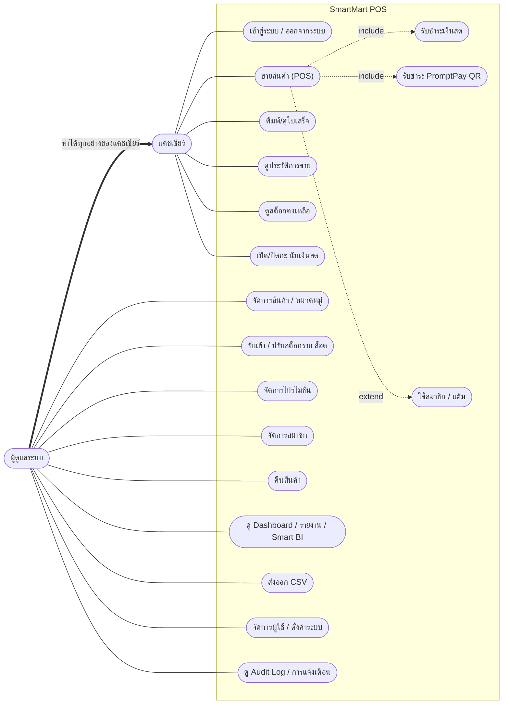
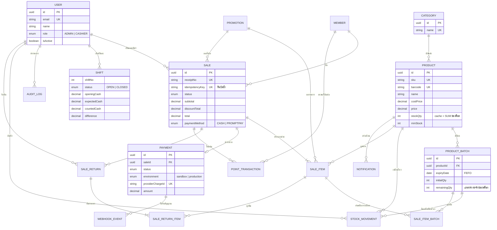

# แผนภาพประกอบการนำเสนอ

เขียนด้วย Mermaid (แสดงผลอัตโนมัติบน GitHub; ถ้าต้องการใส่สไลด์ ให้วางโค้ดที่ https://mermaid.live แล้ว Export เป็น PNG/SVG)

## 1) Use Case Diagram

สิทธิ์: แคชเชียร์เห็นเฉพาะบิลของตนเองและสต็อกแบบอ่านอย่างเดียว; ผู้ดูแลระบบทำได้ทุกอย่าง (บังคับที่ฝั่ง server ทุก Server Action / Route Handler)

## 2) ER Diagram (ตารางหลัก)

แสดงเฉพาะฟิลด์สำคัญ ฐานข้อมูลจริงอยู่ที่ `prisma/schema.prisma`

จุดออกแบบที่ควรพูดตอนนำเสนอ
- **สต็อกจริงอยู่ที่ล็อต** (`ProductBatch.remainingQty`) ส่วน `Product.stockQty` เป็นค่าสะสมเพื่อแสดงผลเร็ว และแก้ได้ผ่าน service เท่านั้น
- **ตัดสต็อกแบบ FEFO** (หมดอายุก่อนตัดก่อน) บันทึกว่าตัดจากล็อตไหนใน `SaleItemBatch` จึงคืนสินค้ากลับล็อตเดิมได้
- **ราคา/ส่วนลดเก็บเป็น snapshot** ในบิล (ชื่อโปรโมชัน ราคาต่อหน่วย) เปลี่ยนราคาทีหลังไม่กระทบบิลเก่า
- **`idempotencyKey`** กันกดจ่ายซ้ำ / เน็ตกระตุกแล้วบิลซ้ำ
- **สถานะ Payment เป็น PAID ได้ทางเดียว** คือหลังเรียก API ผู้ให้บริการยืนยันเอง Webhook เป็นเพียงสัญญาณ
- **ความสัมพันธ์หลักใช้ `onDelete: Restrict`** จึงลบสินค้า/ผู้ใช้/สมาชิกที่มีประวัติอ้างอิงไม่ได้ (ใช้ปิดการใช้งานแทน); มีเพียงรายการลูกของบิล (`SaleItem`, `SaleItemBatch`, `SaleReturnItem`) และการแจ้งเตือนที่ลบตามแม่
